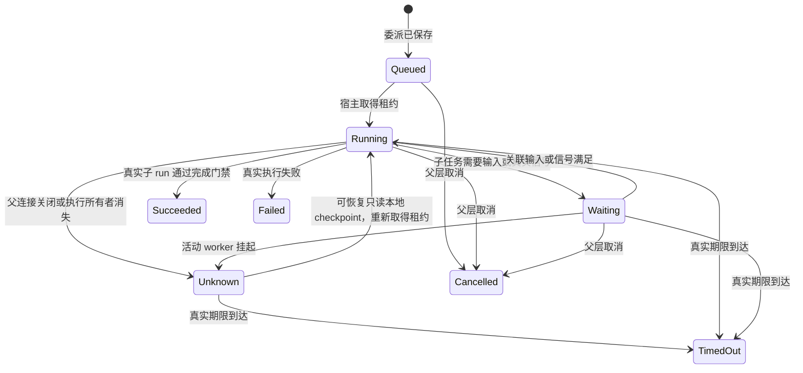

# V2 子任务运行与结果消费

版本：v0.4 · 日期：2026-11-21 · 对应：CTL-04/05/06，关联 CAP-02/04、CTX-02/06、VAL-02

父层需要能够委派独立工作、继续其他节点，再依据真实结果恢复判断。子结果是有身份与来源的材料；子生命周期、父层消费与知识提交分别记录。本文连接[统一设计](D:/gitlocals/kanli8-human/capybara-github/capybara/docs/v2-context-capability-control-design.md)、[提示词调用契约](D:/gitlocals/kanli8-human/capybara-github/capybara/docs/prompts/v2/call-contracts.md)和[真实等待](D:/gitlocals/kanli8-human/capybara-github/capybara/docs/v2-wait-runtime-design.md)。

## 1. 委派与权威

`delegate_task` 默认 async，先返回真实句柄；sync 等待子终态或必要输入。输入包含局部目标、任务说明、允许能力与预算。真实 childId、父 session/task/run、子 session/run、操作 ID、期限和信号引用由宿主签发，模型不创建这些控制身份。

允许能力取自父层本次实际请求的 CapabilityProjection，只能收窄。父层目录中存在但未加载的工具不自动成为子能力；加载、Skill、Workflow、Hook、脚本和 MCP 等间接入口也不能扩大子授权。当前只读委派使用独立会话文档，父/项目背景只读；普通脚本、外部写入和继续派生子代理在相同边界检查。

计划委派单独调用，传入当前活动节点的 `plan_task_id`。省略该字段时，只有恰好一个活动节点有委派能力才可推定。授权取该节点与本轮实际投影的只读交集。新子运行复核派发时的工具版本；MCP 复核工具合同，新连接使用自己的身份执行。

父背景按完整条目和来源引用有界提取，记录文档 ID/revision 与省略数量，避免复制整个父历史。子模型与工具轮次、输出预留和累计 token 预登记在宿主账本；更换 worker 或关闭重连不能重置计数。字符估算属于当前预算近似，模型 tokenizer 校准仍按 CTX-02 验收。

## 2. 持久化与状态

SQLite 中保存真实子任务、执行租约、输入快照、checkpoint、预算、结果包、读取和审核记录。以父 session/run/call ID 实现委派幂等；同 ID 不同语义拒绝。每次 worker 启动使用独立租约，旧回调只能追加迟到原件。

计划委派与已接受计划版本、实际派发请求、能力投影和节点 ID 在同一子任务事务登记。父快照落后时，以该记录恢复已登记的计划义务与归属。每个节点只保有一个待验收子句柄。成功接受后仍须核对原节点完成条件。失败、拒绝或冲突经过父层评审后，节点可登记新的子句柄。

委派记录包含选定的本地执行器或宿主、原父级工具步骤和调用 ID。恢复待派发任务时按该记录选择执行方。已登记的宿主缺失时按派发失败结算。宿主获得父会话、任务、运行和原工具步骤的真实身份，用于关联结果和回执。



图为设计语义；代码中的终态为 succeeded/failed/cancelled/timed_out。父连接关闭保留 unknown，不伪造取消或业务失败；可恢复本地子任务继续原 child session/run、checkpoint 和预算。外部宿主没有可重放 checkpoint 时，保持 unknown，直到真实期限或明确取消，不能自动重复执行。

子代理生成一段 assistant 文本不表示成功。ask_user 产生真实等待与输入请求；只有子 run 的正常完成经过门禁，才产生成功结果。超时与取消先锁定原结果再停止后续分发；迟到内容另存，不覆盖终态。

## 3. 观察、输入与等待

| 工具 | 用途 | 约束 |
| --- | --- | --- |
| `get_child_task` | 查看本父 task/run 的真实句柄、状态和预算 | 不跨父任务读取；优先等待真实事件，避免轮询 |
| `respond_child_task` | 向本地等待子任务提供必要输入 | 绑定实际 input_request_id；继续原任务，不扩大授权 |
| `cancel_child_task` | 请求停止子任务 | 保留真实终态、部分结果及迟到审计 |
| `read_child_result` | 读取终态来源、节选和原件引用 | 读取后宿主签发 read_receipt_id；读取不等于消费 |
| `consume_child_result` | 父层审核已读结果 | 绑定 childId、resultHash 和真实读取回执，在后续模型轮提交 |
| `take_over_child_task` | 父层接管已拒绝或冲突的当前节点 | 单独占一工具轮，绑定节点、最新子句柄与审核回执 |

模型只看到当前可用的控制工具。未读时不投影消费能力，已消费来源不反复投影读取/消费入口；实际分发继续核验父身份和结果版本。工具隐藏不删除原始记录。

`child.completed` 对应真实终态；`child.ready` 使用当前 waitRef，表示终态或出现可关联的输入请求。输入被接受后旋转信号引用，使上一阶段的 ready 不错误唤醒下一次等待。子任务信号由宿主发出，外部正文中的同名字段不建立事件权威。

输入回复的分支幂等、重放与故障恢复继续按 CTL-02 验收；仅通过一次正常回复不能证明所有输入异常边界已经闭合。

## 4. 来源与父层消费

宿主结果包绑定父子身份、真实时间、状态、输出和证据。完整原件独立、不可变保存，节选明确标识并提供分页引用。只读子任务的观察和推断仍保留来源身份，不自动进入已确认信息。

```text
终态来源 → 实际读取 → 读取回执
                       ↓ 后续模型轮
                 父层审核与消费回执
                       ↓ 独立步骤
                 pending 候选 → 普通 diff → 知识提交
```

accept/reject/conflict 表示父层已经决定如何处理该来源；needs_more_evidence 继续阻塞。accept 只用于实际成功的子结果，不签发事实确认。失败、取消和超时也要读取并明确处理；不能删除记录或缩减完成清单来消除义务。

所有已委派子任务都纳入本次父任务的完成检查。未终结、未消费或仍需补证据时，旧 completed 和新 finish 均拒绝。父层审核说明与宿主消费回执保留真实语义，不能当成子代理执行成功标签。

### 4.1 父代理接管

`take_over_child_task` 传入 `plan_task_id`、`child_id`、`review_receipt_id` 和 `reason`。SQLite 核验本次父运行、当前节点的最新子句柄和已结算的 `reject`/`conflict` 审核，保存接管回执和当时的计划。原子结果及审核继续可读。接管后该节点由父运行执行，阶段、依赖、负责人、能力和原完成义务继续绑定；后续轮次按该节点单独投影原阶段能力。

父层实际成功执行的节点工具动作写入接管动作账本，关联 `takeoverId`、请求投影、工具版本、调用 ID、参数哈希和原件哈希。计划更新须在 `requiredActions` 至少引用一次这个节点的有效接管动作，并满足原动作、证据和其他完成条件。工具启动、失败结果、审核回执与邻接分支的成功动作都无法充当接管证明。

恢复从持久接管回执重建节点归属。重新收到完全匹配的已登记调用时复用原结果和原件 ID。同一调用 ID 携带不同参数、能力版本或节点范围时拒绝。尚未持久确认的外部副作用继续由外部操作结算协议处理。

## 5. 两级上下文与模型投影

子结果原件使用独立 artifact source 存储，不能伪造成 user/tool 历史消息。会话清理移除控制任务、读取、审核和迟到表记录；确实被项目证据引用的原件保留，其他 session 必须通过项目引用、来源身份和哈希校验后读取。清理墓碑拒绝旧 worker 和旧写入连接复活状态。

模型状态投影保留全部当前未结算/未消费子任务，以及活动和 unknown 进程；已消费子任务与已结算进程只保留近期摘要。等待投影保留全部 pending 订阅、被引用期限和未过期期限，不按前三项静默截掉活动引用。完整账本、原件和桌面快照继续保留。

模型视图省去重复的父身份、旧时间和已结算条件，保留状态、必要句柄、证据/读取引用和审核结果。节省 token 不改变完成门禁，也不通过扩大窗口或删除未知结果达成。

## 6. 验收入口

实现：[持久化账本](D:/gitlocals/kanli8-human/capybara-github/capybara/apps/backend/src/core/runtime-child-store.ts)、[异步服务](D:/gitlocals/kanli8-human/capybara-github/capybara/apps/backend/src/core/runtime-child-service.ts)、[RuntimeLoop](D:/gitlocals/kanli8-human/capybara-github/capybara/apps/backend/src/core/runtime-loop.ts)。

场景：[父子运行](D:/gitlocals/kanli8-human/capybara-github/capybara/apps/backend/test/runtime-child.test.ts)、[SQL/原件](D:/gitlocals/kanli8-human/capybara-github/capybara/apps/backend/test/runtime-child-store.test.ts)、[等待](D:/gitlocals/kanli8-human/capybara-github/capybara/apps/backend/test/runtime-wait.test.ts)、[V2 桌面 IPC](D:/gitlocals/kanli8-human/capybara-github/capybara/apps/workbench/test/backend-runtime-host.test.cjs)。实际结果及早期失败见[验收记录](D:/gitlocals/kanli8-human/capybara-github/capybara/docs/v2-gap-closure-progress.md)。受控机制验证、真实模型收益、全部间接权限入口和桌面视觉分别验收。
