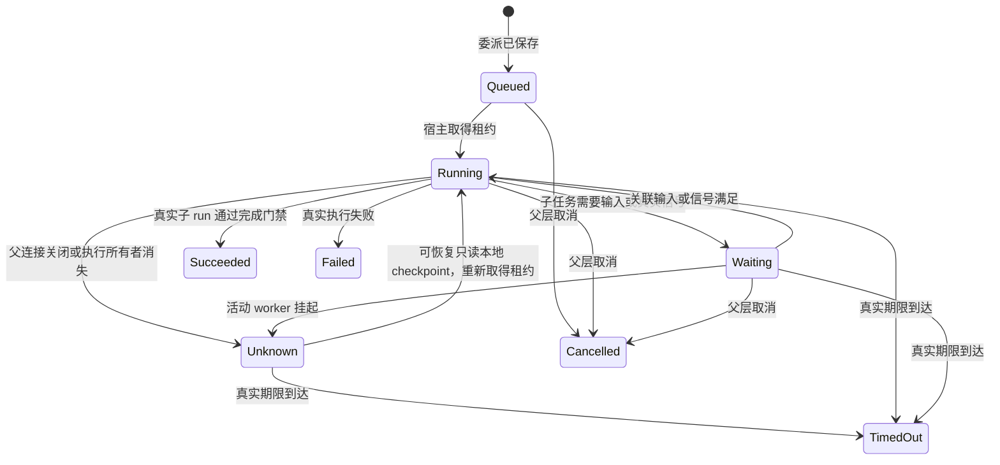

# V2 子任务运行与结果消费

版本：v0.6 · 日期：2026-11-24 · 对应：CTL-04/05/06，关联 CAP-02/04、CTX-02/06、VAL-02

实现状态：父层等待屏障、`delegation_wait`/`delegation_review`、批量委派前置校验、只读/动作运行模式和动作租约已经接入 RuntimeLoop 与子任务账本。

父层可以一次性委派一个或多个独立子任务，随后进入等待屏障，等子任务批次结算后再统一读取、审核并恢复自己的执行。子代理负责被授权范围内的完整工作，不能继续派生子代理。子结果是有身份与来源的材料；子生命周期、父层消费与知识提交分别记录。本文连接[统一设计](D:/gitlocals/kanli8-human/capybara-github/capybara/docs/v2-context-capability-control-design.md)、[提示词调用契约](D:/gitlocals/kanli8-human/capybara-github/capybara/docs/prompts/v2/call-contracts.md)和[真实等待](D:/gitlocals/kanli8-human/capybara-github/capybara/docs/v2-wait-runtime-design.md)。

## 1. 委派与权威

`delegate_task` 默认创建异步子任务，但父层在委派批次提交后进入等待屏障。单个委派可以使用 sync 语义等待单个子终态，多个委派使用批次的 `joinPolicy: all` 等待全部子任务结算。输入包含局部目标、任务说明、允许能力与预算。真实 childId、父 session/task/run、子 session/run、操作 ID、期限和信号引用由宿主签发，模型不创建这些控制身份。

允许能力取自父层本次实际请求的 CapabilityProjection，只能收窄。父层目录中存在但未加载的工具不自动成为子能力；加载、Skill、Workflow、Hook、脚本和 MCP 等间接入口也不能扩大子授权。当前只读委派使用独立会话文档，父/项目背景只读；普通脚本和外部写入继续接受能力边界检查。子代理始终不能继续派生子代理，`A2A delegation depth` 固定为 1。

计划委派使用当前活动节点的 `plan_task_id`。省略该字段时，只有恰好一个活动节点有委派能力才可推定。多个子任务应通过一个委派批次提交，每个子任务绑定不同的活动节点。宿主先完整校验批次，再原子创建子任务。授权取该节点与本轮实际投影的交集。新子运行复核派发时的工具版本；MCP 复核工具合同，新连接使用自己的身份执行。

父背景按完整条目和来源引用有界提取，记录文档 ID/revision 与省略数量，避免复制整个父历史。子模型与工具轮次、输出预留和累计 token 预登记在宿主账本；更换 worker 或关闭重连不能重置计数。字符估算属于当前预算近似，模型 tokenizer 校准仍按 CTX-02 验收。

## 2. 持久化与状态

SQLite 中保存真实子任务、执行租约、输入快照、checkpoint、预算、结果包、读取和审核记录。以父 session/run/call ID 实现委派幂等；同 ID 不同语义拒绝。每次 worker 启动使用独立租约，旧回调只能追加迟到原件。

计划委派与已接受计划版本、实际派发请求、能力投影和节点 ID 在同一子任务事务登记。父快照落后时，以该记录恢复已登记的计划义务与归属。每个节点只保有一个待验收子句柄。成功接受后仍须核对原节点完成条件。失败、拒绝或冲突经过父层评审后，节点可登记新的子句柄。

委派记录包含选定的本地执行器或宿主、原父级工具步骤和调用 ID。恢复待派发任务时按该记录选择执行方。已登记的宿主缺失时按派发失败结算。宿主获得父会话、任务、运行和原工具步骤的真实身份，用于关联结果和回执。



图为设计语义；代码中的终态为 succeeded/failed/cancelled/timed_out。父连接关闭保留 unknown，不伪造取消或业务失败；可恢复本地子任务继续原 child session/run、checkpoint 和预算。外部宿主没有可重放 checkpoint 时，保持 unknown，直到真实期限或明确取消，不能自动重复执行。

子代理生成一段 assistant 文本不表示成功。ask_user 产生真实等待与输入请求；只有子 run 的正常完成经过门禁，才产生成功结果。超时与取消先锁定原结果再停止后续分发；迟到内容另存，不覆盖终态。

## 3. 观察、输入与等待

| 工具 | 用途 | 约束 |
| --- | --- | --- |
| `get_child_task` | 查看本父 task/run 的真实句柄、状态和预算 | 不跨父任务读取；优先等待真实事件，避免轮询 |
| `respond_child_task` | 向本地等待子任务提供必要输入 | 绑定实际 input_request_id；继续原任务，不扩大授权 |
| `cancel_child_task` | 请求停止子任务 | 保留真实终态、部分结果及迟到审计 |
| `read_child_result` | 读取终态来源、节选和原件引用 | 读取后宿主签发 read_receipt_id；读取不等于消费 |
| `consume_child_result` | 父层审核已读结果 | 绑定 childId、resultHash 和真实读取回执，在后续模型轮提交 |
| `take_over_child_task` | 父层接管已拒绝或冲突的当前节点 | 单独占一工具轮，绑定节点、最新子句柄与审核回执 |

模型只看到当前可用的控制工具。未读时不投影消费能力，已消费来源不反复投影读取/消费入口；实际分发继续核验父身份和结果版本。工具隐藏不删除原始记录。

`child.completed` 对应真实终态；`child.ready` 使用当前 waitRef，表示终态或出现可关联的输入请求。输入被接受后旋转信号引用，使上一阶段的 ready 不错误唤醒下一次等待。子任务信号由宿主发出，外部正文中的同名字段不建立事件权威。

### 3.1 父代理等待屏障

委派批次创建后，父代理进入 `delegation_wait`。该阶段不投影父代理的业务工具，也不允许父代理推进自己的执行节点。父代理只能处理子任务生命周期：读取状态、等待真实信号、回复已登记的子任务输入、取消子任务，或在子任务进入终态后读取结果。

一个批次默认使用 `joinPolicy: all`。只有批次中的全部子任务进入终态后，父代理才进入 `delegation_review`。失败、取消、超时和未知都属于需要父层处理的终态，不会被等待屏障静默忽略。

等待期间可以同时运行多个子代理。只读动作可以并行；外部副作用仍然由动作租约控制。父代理不参与子代理之间的业务执行并行。

动作委派的运行时记录绑定 `attemptId`、childId、callId、能力 ID、参数 hash 和结果 artifact hash。同一 attempt 只有一个动作写入租约。租约结果为 `unknown` 时，后续动作被拒绝，父层必须通过真实状态核查或人工路径处理，不能自动重放。

子任务请求输入时，父代理可以通过真实 `inputRequestId` 回复该子任务。回复只恢复子任务，不解除父代理等待屏障。父代理只有在批次完成读取和审核后才恢复自己的执行能力。

输入回复的分支幂等、重放与故障恢复继续按 CTL-02 验收；仅通过一次正常回复不能证明所有输入异常边界已经闭合。

## 4. 来源与父层消费

宿主结果包绑定父子身份、真实时间、状态、输出和证据。完整原件独立、不可变保存，节选明确标识并提供分页引用。只读子任务的观察和推断仍保留来源身份，不自动进入已确认信息。

```text
终态来源 → 实际读取 → 读取回执
                       ↓ 后续模型轮
                 父层审核与消费回执
                       ↓ 独立步骤
                 pending 候选 → 普通 diff → 知识提交
```

accept/reject/conflict 表示父层已经决定如何处理该来源；needs_more_evidence 继续阻塞。accept 只用于实际成功的子结果，不签发事实确认。失败、取消和超时也要读取并明确处理；不能删除记录或缩减完成清单来消除义务。

所有已委派子任务都纳入本次父任务的完成检查。未终结、未消费或仍需补证据时，旧 completed 和新 finish 均拒绝。父层审核说明与宿主消费回执保留真实语义，不能当成子代理执行成功标签。

### 4.1 父代理接管

`take_over_child_task` 传入 `plan_task_id`、`child_id`、`review_receipt_id` 和 `reason`。SQLite 核验本次父运行、当前节点的最新子句柄和已结算的 `reject`/`conflict` 审核，保存接管回执和当时的计划。原子结果及审核继续可读。接管后该节点由父运行执行，阶段、依赖、负责人、能力和原完成义务继续绑定；后续轮次按该节点单独投影原阶段能力。

父层实际成功执行的节点工具动作写入接管动作账本，关联 `takeoverId`、请求投影、工具版本、调用 ID、参数哈希和原件哈希。计划更新须在 `requiredActions` 至少引用一次这个节点的有效接管动作，并满足原动作、证据和其他完成条件。工具启动、失败结果、审核回执与邻接分支的成功动作都无法充当接管证明。

恢复从持久接管回执重建节点归属。重新收到完全匹配的已登记调用时复用原结果和原件 ID。同一调用 ID 携带不同参数、能力版本或节点范围时拒绝。尚未持久确认的外部副作用继续由外部操作结算协议处理。

## 5. 两级上下文与模型投影

子结果原件使用独立 artifact source 存储，不能伪造成 user/tool 历史消息。会话清理移除控制任务、读取、审核和迟到表记录；确实被项目证据引用的原件保留，其他 session 必须通过项目引用、来源身份和哈希校验后读取。清理墓碑拒绝旧 worker 和旧写入连接复活状态。

模型状态投影保留全部当前未结算/未消费子任务，以及活动和 unknown 进程；已消费子任务与已结算进程只保留近期摘要。等待投影保留全部 pending 订阅、被引用期限和未过期期限，不按前三项静默截掉活动引用。完整账本、原件和桌面快照继续保留。

模型视图省去重复的父身份、旧时间和已结算条件，保留状态、必要句柄、证据/读取引用和审核结果。节省 token 不改变完成门禁，也不通过扩大窗口或删除未知结果达成。

## 6. 验收入口

实现：[持久化账本](D:/gitlocals/kanli8-human/capybara-github/capybara/apps/backend/src/core/runtime-child-store.ts)、[异步服务](D:/gitlocals/kanli8-human/capybara-github/capybara/apps/backend/src/core/runtime-child-service.ts)、[RuntimeLoop](D:/gitlocals/kanli8-human/capybara-github/capybara/apps/backend/src/core/runtime-loop.ts)。

场景：[父子运行](D:/gitlocals/kanli8-human/capybara-github/capybara/apps/backend/test/runtime-child.test.ts)、[SQL/原件](D:/gitlocals/kanli8-human/capybara-github/capybara/apps/backend/test/runtime-child-store.test.ts)、[等待](D:/gitlocals/kanli8-human/capybara-github/capybara/apps/backend/test/runtime-wait.test.ts)、[V2 桌面 IPC](D:/gitlocals/kanli8-human/capybara-github/capybara/apps/workbench/test/backend-runtime-host.test.cjs)。实际结果及早期失败见[验收记录](D:/gitlocals/kanli8-human/capybara-github/capybara/docs/v2-gap-closure-progress.md)。受控机制验证、真实模型收益、全部间接权限入口和桌面视觉分别验收。

## 7. 当前实现状态

### 7.1 已具备的协议能力

当前实现已经覆盖父子任务的基础生命周期：

- 父代理通过 `delegate_task` 创建带有真实身份的子任务。
- 子任务拥有独立的 child session、child run、预算和等待句柄。
- `RuntimeChildStore` 以父 session、父 run 和调用 ID 保存幂等委派记录。
- 子任务支持 `queued`、`running`、`waiting`、`succeeded`、`failed`、`unknown`、`cancelled` 和 `timed_out` 状态。
- 父代理可以读取子结果，获得 `resultHash` 和 `readReceiptId`，再提交消费审核。
- 消费审核支持 `accept`、`reject`、`conflict` 和 `needs_more_evidence`。
- 被拒绝或产生冲突的子结果可以进入父代理接管流程。
- 迟到结果作为独立记录保留，不覆盖已经结算的子任务状态。
- `createHttpChildAgentHost` 已提供 `capybara.a2a.child.v1` 的只读 HTTP 适配器，外部响应必须回显请求身份并通过大小、超时和 JSON 结构校验。
- 独立进程宿主、父层读取/消费和完成门禁已有 3/3 定向测试，动作模式仍由本地租约路径承载。

### 7.2 当前执行边界

父层委派逻辑目前只从当前投影中筛选 `sideEffects: none` 的能力，并排除文件写入、文件删除和进程执行权限。子代理提示词也将当前委派描述为只读委派。

AppWorld 的 `appworld_execute` 具有外部副作用，并且声明 `replay: never`。因此当前 A2A 可以完成资源检索、资料核对和只读分析，不能独立执行 AppWorld 状态修改。

代码和测试已经覆盖父子生命周期、读取、审核、等待、超时和接管。第一轮 AppWorld 正式运行没有产生 `delegate_task`、`read_child_result` 或 `consume_child_result` 记录，尚未形成真实 AppWorld 子代理执行样本。

## 8. 独立执行型 A2A 的缺口

以下缺口只涉及 A2A 协议和子代理运行，不扩展到其他系统模块。

### 8.1 缺少执行模式

当前 `ChildSpec` 只有能力列表，没有明确区分：

- 只读协作
- 可逆动作执行
- 外部副作用执行

子代理是否可以执行外部动作目前由统一的只读过滤决定，无法表达经过父代理明确授权的独立执行任务。

### 8.2 缺少外部动作租约

当前有子任务执行租约，但没有外部副作用租约。缺少以下约束：

- 哪个子代理当前拥有外部写入权
- 租约允许调用哪些工具
- 租约允许作用于哪个任务或资源范围
- 租约的最大调用次数和有效期限
- 租约结束后是否完成验证

没有动作租约时，父代理和子代理可能同时修改同一个有状态环境。

### 8.3 缺少统一动作账本

当前结果包可以保存输出和 evidence，但没有统一的子代理动作记录结构。独立执行需要对每个外部动作保存：

- `attemptId`
- `childId`
- `leaseId`
- `callId`
- `stepId`
- 工具名称
- 参数 hash
- 结果 artifact
- 副作用状态
- 验证回执

父代理接管时必须依据动作账本处理剩余工作，不能重新执行整个子任务。

### 8.4 缺少标准化完成合同

当前子任务有目标和父计划节点，但没有统一要求子代理提交：

- 已完成的条件
- 已完成条件对应的动作回执
- 已验证的最终状态
- 尚未完成的条件
- 未知副作用

子代理可能返回一段看似完整的摘要，父代理却无法直接判断局部目标是否满足。

### 8.5 子结果没有完整承载动作回执

当前父层通过结果 hash、读取回执和 evidence 审核子结果。独立动作型子代理还需要将成功动作、验证动作和未结动作作为结构化字段返回。

否则父层只能看到结果摘要，无法准确区分：

- 子代理实际执行过的动作
- 子代理计划执行但没有执行的动作
- 工具返回未知的动作
- 已执行但尚未验证的动作

### 8.6 子预算与根预算的关系不够明确

子任务已经有模型轮数、工具轮数和 token 上限。协议还需要明确：

- 子任务预算是否从父任务总预算中预留
- 子代理实际消耗如何回冲根任务
- 多个子代理如何竞争剩余预算
- 父代理能否在预算不足时继续执行

独立执行模式需要防止通过拆分大量子任务绕过根任务预算。

### 8.7 执行上下文缺少标准胶囊

当前父上下文按有界条目传入子代理。独立执行还需要固定的任务执行胶囊，至少包含：

- 局部目标
- 约束
- 完成条件
- 可修改范围
- 禁止修改范围
- 已确认事实
- 必要证据
- 已有动作回执
- 当前状态摘要
- 预算和能力授权

父代理完整消息历史不应直接复制给子代理，子代理也不能依靠未授予的历史内容补足权限。

### 8.8 A2A 与单次尝试的绑定不完整

当前子任务绑定父 session、task 和 run。独立外部执行还需要显式绑定 `attemptId` 和当前环境标识。

这可以防止：

- 同一题创建新的子任务执行第二次
- 子任务恢复到另一个环境
- 子任务结果被另一个 attempt 消费
- 取消后的外部动作被无条件重放

### 8.9 缺少成本感知的委派准入

当前是否委派主要由模型决定。协议还需要提供委派准入依据：

- 预计子任务轮数
- 预计工具调用数
- 上下文复制成本
- 父代理可并行推进的工作量
- 结果审核成本
- 子任务失败后的接管成本

简单的一步工具调用不应因为委派而产生额外的模型和审核开销。

### 8.10 缺少独立执行型 A2A 的真实验收样本

现有测试能够验证协议生命周期，但 AppWorld 正式运行没有真实子代理动作、动作回执和父层消费记录。

还需要验证：

- 子代理独立调用被授权的外部工具
- 父代理不重复执行子代理已完成的动作
- 子代理结果经过读取和消费后才能验收节点
- 子代理失败后父代理能够接管剩余工作
- 未知副作用不会触发自动重试
- 父子预算合计不超过根任务预算

## 9. 实施方案

### 9.1 第一阶段，扩展委派合同

在现有 `ChildSpec` 和 `RuntimeChildSession` 上增加 A2A 专属字段：

```json
{
  "attemptId": "attempt-...",
  "delegationMode": "readonly | action",
  "contextRefs": ["session-entry-...", "evidence-..."],
  "completionConditions": ["..."],
  "budget": {
    "rootRemainingTokens": 180000,
    "childReservedTokens": 60000,
    "maxModelRounds": 8,
    "maxToolRounds": 12
  }
}
```

`readonly` 保持当前行为。`action` 只表示子代理获得了执行资格，具体工具仍然必须经过父层计划节点和当前能力投影授权。

### 9.2 第二阶段，实现动作租约

增加外部动作租约记录：

```json
{
  "leaseId": "lease-...",
  "attemptId": "attempt-...",
  "childId": "child-...",
  "allowedTools": ["appworld_execute"],
  "scope": "current-appworld-task",
  "maxCalls": 12,
  "expiresAt": "...",
  "verificationRequired": true
}
```

运行时负责：

- 同一有状态环境只授予一个外部写入租约。
- 只读动作可以并行，外部动作按租约串行执行。
- `replay: never` 的动作不允许无条件重放。
- 结果未知时保留原动作并进入核查或接管流程。
- 租约过期后拒绝新的外部动作。

### 9.3 第三阶段，统一动作结果包

子任务终态结果增加结构化动作和验证信息：

```json
{
  "status": "succeeded",
  "completedConditions": ["..."],
  "actionReceipts": [
    {
      "callId": "...",
      "toolName": "appworld_execute",
      "resultArtifactId": "...",
      "verificationReceiptId": "..."
    }
  ],
  "unresolved": [],
  "evidenceRefs": ["..."]
}
```

父层只有在读取结果并完成消费审核后，才能使用这些回执验收对应的计划节点。

### 9.4 第四阶段，补齐接管和恢复

接管流程必须读取：

- 子代理已完成动作
- 已验证状态
- 未完成条件
- 未知副作用
- 最后一条有效动作回执

父代理接管后只处理剩余状态。原有动作不能因为子代理失败而自动重放。

当 worker 消失时：

- 只读任务可以恢复原 child session 和 checkpoint。
- 已经产生外部副作用的任务保持 `unknown`，先核查状态。
- 没有明确结算前，不得创建新的动作尝试。

### 9.5 第五阶段，接入根任务预算和成本准入

委派前由运行时预留子任务预算。子代理实际消耗回写根任务预算。

建议保留以下限制：

- 子代理委派深度为 1。
- 同一父任务最多 8 个活动子任务。
- 同一环境最多 1 个外部写入租约。
- 子代理具有独立预算，且不能超过根任务剩余预算。
- 父代理在等待屏障期间可以取消未结算的子任务，但不能继续自己的业务执行。

### 9.6 第六阶段，实现批量委派和等待屏障

父代理采用批次委派模型。批次内容至少包含：

```json
{
  "joinPolicy": "all",
  "children": [
    {
      "planTaskId": "task-a",
      "goal": "完成局部目标 A",
      "capabilityIds": ["..."],
      "budget": {"maxModelRounds": 8, "maxToolRounds": 12, "maxTotalTokens": 60000}
    },
    {
      "planTaskId": "task-b",
      "goal": "完成局部目标 B",
      "capabilityIds": ["..."],
      "budget": {"maxModelRounds": 8, "maxToolRounds": 12, "maxTotalTokens": 60000}
    }
  ]
}
```

运行时按以下顺序处理：

1. 校验所有子任务的计划节点、能力、预算和上下文引用。
2. 原子保存整个委派批次，任何一个子任务不通过时不创建批次内的其他子任务。
3. 并行启动通过校验的子代理。
4. 将父代理阶段切换为 `delegation_wait`，移除父代理业务工具投影。
5. 等待全部子任务进入终态。
6. 将父代理阶段切换为 `delegation_review`，投影读取和审核能力。
7. 父代理读取并消费全部子结果。
8. 验收已满足的计划节点，再恢复父代理的下一阶段能力。

委派批次中的 `delegate_task` 不能和普通业务工具混合。已存在活动子任务时，父代理不能通过新的普通计划轮绕过等待屏障。

### 9.7 第七阶段，建立 A2A 专项验收

专项验收只覆盖 A2A：

1. 父代理创建一个只读子任务并消费成功结果。
2. 父代理创建一个独立执行子任务，子代理调用被授权的外部工具。
3. 子代理返回动作回执和最终验证结果。
4. 父代理读取并接受结果，且不重复执行动作。
5. 子代理返回冲突结果，父代理拒绝并接管节点。
6. 子代理产生未知副作用，系统阻止重复动作。
7. 子代理等待输入，父代理按真实 input request 恢复子任务。
8. 子代理预算耗尽，父代理能够读取失败结果并决定接管或结束。
9. 两个只读子任务在同一委派批次并行执行，父代理在批次结算前不能调用业务工具。
10. 一个外部写入子任务持有动作租约，另一个外部写入子任务必须等待租约结算。
11. 所有子任务结果、动作回执和消费回执可以在父运行中重放和审计。

### 9.8 第八阶段，外部子代理宿主传输合同

`childAgentHost` 的进程内回调不能作为外部宿主验收证据。外部宿主使用独立 HTTP 请求承载一个只读子任务，运行时发送版本化、可重放和有界的请求包，宿主返回带身份回显的结果包。模型对象、回调函数和密钥不进入请求包。

请求包固定为 `capybara.a2a.child.v1`：

```json
{
  "protocol": "capybara.a2a.child.v1",
  "requestId": "parent-call-id",
  "parent": {"sessionId": "...", "taskId": "...", "runId": "...", "stepId": "..."},
  "child": {"childId": "...", "sessionId": "..."},
  "attemptId": "...",
  "mode": "readonly",
  "goal": "局部目标",
  "prompt": "受限任务说明",
  "parentContext": "有界上下文胶囊",
  "projectPath": "宿主工作目录",
  "capabilityIds": ["runtime:search_resources"],
  "capabilities": [],
  "budget": {"maxModelRounds": 4, "maxToolRounds": 8, "maxTotalTokens": 40000}
}
```

响应包必须回显 `protocol`、`requestId`、`childId` 和 `childSessionId`，并只携带 `ok`、`output`、`evidence`、`actionReceipts`、`error`、`startedAt`、`completedAt` 和 `durationMs`。运行时拒绝协议版本、请求身份、JSON 结构、响应大小或超时不符合合同的结果。HTTP 宿主不接收 `llm`、`AbortSignal`、授权回调或结果回写回调，避免把父进程闭包伪装成远程能力。

第一阶段外部宿主只接受 `readonly`。`action` 任务必须继续走本地宿主，或者在另行定义动作桥接协议并绑定真实动作租约后才允许外置。外部宿主失败、超时、身份回显不一致或返回未知副作用时，子任务按真实失败/未知状态结算，不能自动重试。

外部宿主验收方案如下：

1. 启动独立进程 HTTP 宿主，不共享父 RuntimeLoop 的函数或内存状态。
2. 父 RuntimeLoop 通过 HTTP 适配器提交只读子任务，宿主校验请求包并回传身份匹配的结果。
3. 父层读取并消费结果，结果包进入原有 artifact、evidence 和完成门禁。
4. 通过身份篡改、协议版本错误、超大响应、超时和非只读模式拒绝用例。
5. 检查父子身份、attempt、能力投影、预算字段和结果 hash 在 trace 中可回放。

## 10. 第一版独立执行边界

第一版独立执行型 A2A 建议采用以下边界：

- 子代理支持 `readonly` 和 `action` 两种模式。
- `action` 模式只允许父计划节点明确授予的工具。
- 外部写入采用单写者租约。
- 父代理通过委派批次同时启动多个子代理。
- 任一活动子代理存在时，父代理进入 `delegation_wait`，暂停自己的业务执行。
- 批次默认使用 `joinPolicy: all`，全部子任务结算后才进入父层审核。
- 子代理深度保持为 1。
- 子代理不能调用 `delegate_task` 或其他委派入口。
- 子代理结果必须携带完成条件、动作回执、验证结果和未完成项。
- 父代理必须读取并消费结果后才能验收委派节点。
- 子代理预算计入父任务总预算。
- 未知外部副作用必须先核查，不能自动重试。
- A2A 结果和动作都绑定同一个 attempt。

这组边界支持子代理独立完成局部工作，同时保留父代理对权限、状态、结果适用范围和最终完成判断的控制。
