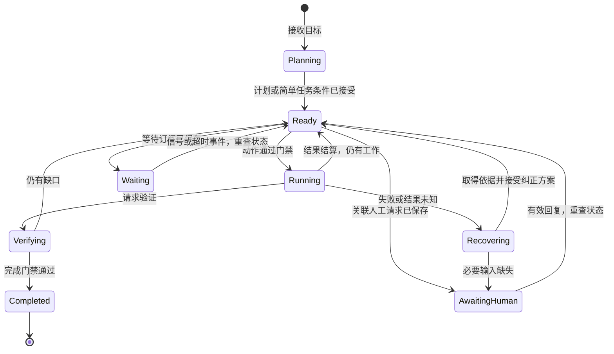

# Capybara V2：上下文、能力、状态闭环与提示词设计

版本：v1.23 · 日期：2026-11-21 · 用途：设计评审基线

本文统一上下文、能力和任务控制的代码核查缺口，并给出适合 Capybara 的提示词与运行协议设计。文中的“已有”表示代码或受控测试提供了相应证据；“目标”表示需要满足的设计条件。历史机制测试通过，不等于本文列出的完整闭环已经达成。

第 4 节统一列出 20 项缺口、已有基础和仍需闭合的条件；原始审计证据保留在第 4.5 节。每次验证的范围与日志保存在[缺口施工与验收记录](D:/gitlocals/kanli8-human/capybara-github/capybara/docs/v2-gap-closure-progress.md)，不能将历史测试结果当作当前全部改动的验收结果。

评审重点是三条闭环：**信息从观察进入可持续更新的两级文档；能力从发现进入受限执行；任务从规划进入可验证的完成、等待或人工协助。** 提示词分别说明如何判断，运行时分别提供可核验的结果。

直接阅读提示词可从[提示词目录](D:/gitlocals/kanli8-human/capybara-github/capybara/docs/prompts/v2/README.md)进入。信息处理样例见[退款排查](D:/gitlocals/kanli8-human/capybara-github/capybara/docs/prompts/v2/review-scenario.md)，状态与能力样例见[控制场景](D:/gitlocals/kanli8-human/capybara-github/capybara/docs/prompts/v2/control-scenarios.md)。

## 0. 统一评审入口

本轮将原有 20 项缺口保留为同一套编号。已有能力继续复用；缺口是否关闭，取决于完整调用链和验收证据，而不是提示词中是否描述了目标行为。

| 评审问题 | 对应缺口 | 需要闭合的结果 |
| --- | --- | --- |
| 信息能否持续承接 | CTX-01～07 | cache 提取、两级文档增量更新、原件保留、归档召回和有界投影共同工作，关键条件与双方证据不丢失 |
| 能力能否准确提供 | CAP-01～05 | 当前角色、阶段、Skill、system tools 与 MCP 对齐；发现、加载、授权、执行、失败恢复分别有真实依据 |
| 任务能否持续推进并正确结束 | CTL-01～06 | 继续、拆解、局部阻塞、人工协助、真实等待、异步子任务和完成检查共享权威账本 |
| 整理是否真的改善任务 | VAL-01～02 | 对照未压缩基线验证语义、召回、下游质量和总成本，训练目标只包含模型应生成的提案 |

真实 V2 退款已经验证同一运行中的计划、独立子代理、人工回复恢复、归档召回、文档回填、交付与第二会话隔离。清运场景完成同题两组三轮对照，计入整理调用后实际 Token 减少 17.4%。冻结异议案例仍有一条由整理器保留为待核对原句，主模型在整理组完整读到并逐字交付。新权重提升仍以独立留出验证为准。[当前验收记录](#47-本次核查的证据边界)

评审时先看[剩余缺口及关闭条件](#46-当前仍需闭合的设计条件)，再核对[提示词设计稿](#85-提示词设计稿)及[状态驱动的提示词片段](#86-状态驱动的提示词片段)。[调用契约](prompts/v2/call-contracts.md)定义每次请求的输入、允许输出、宿主校验和失败后的保留条件。

本次资料核对使用 Anthropic 公开发布的系统提示词与产品文档。公开的网页/移动端提示词、Claude Code 的产品机制、Capybara 自身协议分别标明来源；截图中的上下文分类不作为隐藏提示词原文。

## 1. 先明确系统要做什么

Capybara 帮助用户持续完成真实任务。大模型负责理解、判断、解题和行动决策；上下文整理模型负责信息提取、组织、压缩、归档与召回建议；RuntimeLoop 负责权限、状态、版本、等待、执行和提交。

核心关系是：

```text
价值观 → 判断事实的方法 → 解决问题的方法 → 行为原则 → 运行时门禁和证据

system_prompt + 能力目录 + 已激活 Skills         只读的指令与能力背景
                         ↓
project_context + session_context + 当前消息    大模型的主要工作输入
                         ↓
                    行动与真实观察
                         ↓
                        cache
                         ↓
                  上下文整理模型
                         ↓
               两级文档的局部 diff 建议
                         ↓
          RuntimeLoop 校验、持久化并生成 receipt
                         ↓
             新投影 + 尚未被承接的近期消息
```

我们弱化的是历史 messages 在每次推理中的占用。原始消息、工具结果和执行轨迹仍保留，用于证据追溯、恢复和训练。

## 2. 数据结构和权威边界

| 对象 | 保存什么 | 谁可以提交变更 | 生命周期 |
| --- | --- | --- | --- |
| `system_prompt` | 宪法、运行协议、项目指令 | 系统配置与授权的资源管理入口 | 随提示词版本 |
| 能力目录与工具 schema | system tools、项目工具、MCP 工具的真实定义和权限 | 能力注册与配置机制 | 随能力版本 |
| Skills | 可发现的操作方法、激活正文、引用与脚本索引 | Skill 资源管理机制 | 随资源版本 |
| `project_context` | 项目背景、稳定约束、跨会话有效的知识、决策及其原因 | RuntimeLoop 应用 project scope diff | 跨 session |
| `session_context` | 当前任务背景、已取得的信息、压缩后的工作进展、未决问题和证据索引 | RuntimeLoop 应用 session scope diff | 当前 session，可恢复 |
| `cache` | 工具、网页、文件、子代理及外部事件产生的待整理观察 | 可信的观察摄取入口 | 原件保留，主动窗口有界 |
| `messages` | 原始交互顺序和用户指令 | 消息接收与轨迹记录入口 | 轨迹保留；模型只见必要投影 |
| `runtime_state` | 任务、计划、执行、等待、人工请求、子代理、预算及完成状态 | 运行时事件归约与控制门禁 | 随任务运行并持久化 |

变量以 `session_context` 为规范名称，`context` 为兼容别名。旧 `variables.context.history_summary`、`builtin.cache.summary` 与正式 session 文档是不同载体；统一管线以两级文档和持久化覆盖边界承接信息，避免产生多个摘要真源。

`session_context` 可以写“上次观察到某子任务成功，见 receipt-…”，但当前子任务是否成功仍以 `runtime_state` 和真实收据为准。文档 diff 不能把权限改为已批准、把未知写入改为成功、把父任务改为已完成。

### 2.1 文档与展示

两级上下文都是独立文档，各自拥有 `documentId`、`revision`、稳定节点身份、来源和证据关系。面向阅读可呈现为递归的 `List<List|string>`，采用文档折叠和缩进；节点 ID、证据与 revision 作为元数据保存。

V4 主轮的有界投影用表式节点记录可见父子关系、真实 ID 和 hash，文件证据在同一文档投影里共用已核验的来源。模型用本区行号找到真实绑定。编辑、原件引用和 V2 桌面读取继续依据持久文档与对应回执。[表式投影契约](prompts/v2/call-contracts.md#8-稳定结构化输出与总预算)

Markdown 是可读序列化和模型投影，不承担控制指令或状态迁移协议。现有五区 `ContextDocument` 可以作为内部容器；对整理器和主模型暴露时，必须明确区分文档信息、指令、候选材料与消息轨迹。

### 2.2 状态与任务的层级

```text
project
  └─ session
       ├─ project_context 的只读引用
       ├─ session_context
       └─ task
            ├─ plan / subtask
            ├─ run / model round / tool call
            ├─ human request / wait subscription
            └─ child task / child session
```

一个模型回复结束、一次 run 结束、一个子任务完成、父任务完成和整个 session 结束，分别记录。子代理的 `finish` 只作用于它自己的任务。

### 2.3 文档树与版本化结构编辑

信息文档保存 `tree.version=1`、根节点的有序子节点 ID 和章节节点 `{id,title,children}`。正文条目直接使用既有 information entry ID，章节有独立稳定 ID；标题改名和移动不改变节点身份。旧文档首次读取时按原条目顺序和 headingPath 确定性生成树，原证据、正文和 revision 保留。已有 tree 时校验唯一父节点、无环、无孤立节点以及条目与章节路径的一致性，不根据标题重新生成。

模型与界面仍看到递归 `List<List|string>` 或相应 Markdown，节点身份、结构 hash 和路径映射作为元数据提供。活动视图遵循树的顺序，只显示 active 正文；superseded/archived 的原文、节点和位置留存供追溯与召回。替换正文产生后继条目，保留旧条目谱系，新条目继承旧位置。

V2 工作台连接时从会话快照取得两级文档，随后消费 `runtime.context.documents.updated`。桌面宿主合并同次提交的事件，按文档身份和修订发送当前两级视图。界面只接收当前运行连接的视图。展开状态按工作区、文档和稳定节点 ID 保存在本机，改名和换父节点后从相同身份恢复，切换会话时读取该会话自己的偏好。正文树位于侧栏顶部，渲染诊断和回放序列化按需展开。折叠偏好属于界面状态。

有界投影先为明确固定的候选预留实际序列化空间，包括本轮用户指令和相关召回来源。文档结构和正文使用余下的空间，显示顺序沿用文档树。主模型的结构提案同时绑定本轮可见节点、来源候选及其证据；文档很宽时仍可对少量可见同级节点做局部重排。未列入 `childIds` 的节点保留原位置。

模型 diff 的原始提案和回执在同一次提交中记录真实请求绑定。主轮的 `runtime_state.recentContextEdits` 回传同一会话、任务和运行内最近八条结果。回执的 `sourceRequestId` 表示编辑发生的请求，新的控制提案绑定当前实际请求。若同次运行的完成提案误用已提交编辑的请求 ID，宿主拒绝旧绑定并在有界修复内提供新一轮。主轮 schema 强制每项 `payload` 提供带真实候选来源的非空 `evidenceRefs`。

承担计划节点的编辑在执行阶段使用 `candidateDiffs[].planTaskId`。节点必须属于当前投影的 `activeTaskIds`。实际修改后，事务同时登记 `completionActionRef` 的归属证据。`context:<receiptId>` 在计划和完成门禁中按原会话、运行、根任务与计划节点核验。回滚、幂等重放和 `unchanged` 核验各自保留审计回执，只有实际提交的变更提供计划动作引用。

过期的文档、投影或节点绑定先经现有事务门禁拒绝，完整保留被拒绝的提案和回执。主模型可在有界输出修复预算内使用新投影重新提议；运行时继续核对来源、节点 hash 和作用域。修复请求携带拒绝原因。其它存储或权限错误仍按原失败处理。

原有四类内容 diff 保持版本 1 兼容；结构编辑使用 `diffVersion=2`：

| 算子 | 目标和参数 | 语义 |
| --- | --- | --- |
| `add_heading` | 父节点 ID、title、可选 beforeNodeId | 创建稳定章节节点，不产生知识事实 |
| `rename_heading` | 章节 ID、title | 保留身份与子树，更新派生 headingPath |
| `move_node` | 条目/章节 ID、parentNodeId、可选 beforeNodeId | 在本作用域内移动整个节点，保持正文、证据和谱系 |
| `reorder_children` | 父节点 ID、childIds | 重排给出的同级可见节点，只替换它们原有的槽位；未列出的节点保持原顺序与位置 |

每个结构提案继续绑定候选来源、文档版本和投影，并带目标节点的结构 hash。引用的节点、父节点与位置锚点必须由本次投影提供；禁止环、跨文档引用、重复父节点、非法锚点与未知算子。结构操作不改写正文或事实，不通过拼接整篇 Markdown 重排文档。批次中新增节点的实际 ID 由宿主回执产生，后续依赖操作取得新投影后再提交。

有界投影为必要正文保留优先级，并在补入可选正文前选择用户指令中点名的章节、当前运行新建的章节和必要祖先。空章节可以作为独立的编辑地址进入投影。按树的原顺序输出所选节点，结构元数据计入同一预算。项目候选晋升后的内部投影保留原提案已通过校验的节点引用和候选。完整树随文档事务、序列化、恢复与训练记录保存，界面折叠沿用稳定节点 ID。

改名、移动与局部重排先校验真实投影和来源，再核对目标状态。标题、父节点和目标位置已满足提案时，发放 `result=applied`、`unchanged=true` 的回执，`nextRevision` 等于 `previousRevision`，变更节点和条目为空。回执按幂等键持久化，训练记录保留它的核验结果并只将实际修改归入接受操作。新增章节沿用幂等键标识同一次创建。

当前用户要求由宿主保留为有真实消息来源的会话候选。连续结构编辑可以显式固定同一 accepted 来源候选，保留指令依据；这不恢复 rejected/stale 候选，也不把用户说法自动升为事实。排版提案的成功回执不能单独证明原件中的事实已经承接，因此不据此缩减相关历史。

### 2.4 存储权威、并发与会话清理

SQLite 中的两级文档与覆盖边界是恢复真源。运行快照保存会话和任务的恢复材料；它不能因 revision 较大而覆盖已提交知识。只有缺少权威记录时才允许验证并导入旧快照，导入不能替代已有记录。显式 checkpoint 回退产生新的会话文档版本并重置覆盖边界，原始来源不回滚。

每个存储连接记录自己实际读取的完整状态 hash。写入在事务中同时检查文档身份、revision 和该读取状态；读取版本号、导出镜像或查询展示数据不刷新写入基线。同 revision 的回执或投影更新也参与校验，避免覆盖另一个连接的新状态。失败事务恢复读取基线，重试前显式重新加载。一个 RuntimeLoop 绑定一个 session，不能把原会话知识和历史隐式搬入另一个 session。

独立的存储 `write_version` 随实际写入推进，并与状态正文共同形成读取指纹。即使只提交归档或覆盖边界、文档正文完全相同，也能识别并发提交；它不作为知识 revision 或模型可签发的状态。原件追加的墓碑检查与写入处于同一个事务内。

清理会话在一个事务中移除会话快照、轨迹、会话文档、覆盖边界、归档、召回和提交记录。项目文档继续保留；其证据和候选真实引用的原件保留为项目来源，其他会话原件清除。旧证据未限定 session 且存在同名来源时保留所有匹配原件，不悄悄选一个。清理过的 session 留有墓碑，拒绝旧运行和旧快照再次写入；项目来源读取不依赖原会话仍出现在会话目录中。

### 2.5 投影发布与拒绝审计

投影发布是运行记录。宿主在向模型、检查入口或系统 Hook 提供投影前，保存其实际 Markdown、内容 hash、文档身份、revision、可见条目/候选/树节点，以及会话、请求或命令关联。发布记录和必要的文档元数据在同一事务中保存；失败不发布成功事件，也不发出依赖该投影的模型请求。

模型发布关联完整 runId/requestId，不能只使用会被下一次运行复用的时间线步骤 ID。记录代表宿主准备发出的实际输入，不证明远端模型已接收或理解；模型传输结果另存。主轮只登记实际请求中完整包含的文档投影，不将被裁掉的正文或内部重绑定视作模型已读。

仅元数据提交必须验证知识指纹与当前已读文档完全一致，包括信息/候选区的正文、条目引用和区段版本。它可以保存投影绑定以及宿主生成的 system/tools/messages 元数据，不能改变 information、candidates、evidence、tree 或既有知识回执。冻结项目和只读子代理也能记录读取投影，不能借此修改项目知识。控制记录不参与模型提出的知识 diff。

外部 diff 必须引用当前 session 确实发布过的投影。宿主为引入真实候选而生成的内部重绑定仍需先核验原投影，不把内部宽投影视作模型已经看到的内容。恢复只加载仍匹配当前文档的绑定；原发布正文和旧绑定保留作追溯，不能恢复旧事实或旧权限。

拒绝审计保存原始提案、语义 hash、真实回执、原因及批次/请求关联，在发布拒绝事件前落盘。重试幂等和相同 key 不同语义的冲突分别记录；同一失败不能在重启后变成成功标签。多文档事务失败时，审计标明整批回滚；已提交动作不能因后置记录故障被改标为失败。审计只记真实结果，不给模型签发身份、权限或完成状态。

原始结果与每次传输尝试分别保留。新的 proposalId、请求或命令关联可以复用原幂等回执，但不能修改原回执或用同一回执认领另一个 key。跨作用域批次按原提案逐一匹配回执，不依赖分组顺序或本次 proposalId 等于历史 ID。批次失败时，新动作回滚；原先已提交动作的重放仍引用原成功回执，并同时记录本次批次失败原因。

知识更新或 checkpoint 回退不改写执行历史。独立提案已提交的拒绝结果恢复为幂等记录，不恢复旧事实或成功写入；整批回滚的审计不建立新的动作幂等结果，故障解除后可以重试，原失败尝试保留原标签。保存失败恢复内存，不能留下只存在于内存的成功/拒绝状态。会话清理同时清除发布、原始结果与尝试记录，并以墓碑拒绝旧运行继续写入。

关闭运行先撤销继续执行的代际、唤醒暂停并取消活动工作，再关闭资源与存储。迟到的模型返回不能在关闭后更新文档。步骤后的 Hook、发布或 checkpoint 处理失败使运行进入真实失败状态；已确认的工具结果和文档提交仍保留，不将收尾故障改标为业务执行失败。

## 3. Claude 的哪些做法值得参考

### 3.1 可核查的参考范围

公开来源核对日期为 2026-11-21。

- Anthropic 为 Claude 网页、桌面和移动应用发布核心系统提示词的部分版本。以 Sonnet 4.6 的 2026-11-09 版为例，正文把产品信息、行为要求和知识时效分别组织，以日期占位符表示动态信息。官方将公开版本的使用范围限定在关闭网页搜索的部分对话。[系统提示词发布说明](https://platform.claude.com/docs/en/release-notes/system-prompts/overview) · [Sonnet 4.6 系统提示词](https://platform.claude.com/docs/en/release-notes/system-prompts/claude-sonnet-4-6)
- 同日的 Sonnet 5.5 公开版本将纠错与知识时效各自成段，分别描述如何修正已经发现的错误和如何报告超出可靠知识范围的信息。Capybara 将纠错接到运行回执，将时效判断接到来源与采集时间。[Sonnet 5.5 系统提示词](https://platform.claude.com/docs/en/release-notes/system-prompts/claude-sonnet-5-5)
- Anthropic 将宪法作为塑造 Claude 长期行为的训练依据。Capybara 参考其中对角色目的、价值权衡与硬约束的组织方式。[Claude’s Constitution](https://www.anthropic.com/constitution)
- Claude Code 公开说明了上下文窗口如何随会话推进，项目指令、自动记忆、工具描述和 Skill 如何装载，以及子代理如何使用独立上下文。Capybara 据此比较产品行为。[上下文窗口](https://code.claude.com/docs/en/context-window) · [记忆机制](https://code.claude.com/docs/en/memory) · [Skills](https://code.claude.com/docs/en/skills) · [子代理](https://code.claude.com/docs/en/sub-agents)
- Claude Code 的 MCP Tool Search 允许先加载工具名和服务器指令，再按需取得工具定义。Capybara 将工具可发现性与本轮实际分发权分别建模。[Claude Code MCP Tool Search](https://code.claude.com/docs/en/mcp#scale-with-mcp-tool-search)
- Claude Code 官方设置文档说明其系统提示词未公开。Claude 应用发布版本支持核对提示词的组织和措辞，Claude Code 文档支持核对工具、权限、记忆和委派行为。[Claude Code 设置](https://code.claude.com/docs/en/settings#change-a-setting)
- Anthropic 的[上下文工程文章](https://www.anthropic.com/research/effective-context-engineering-for-ai-agents)用于参考明确分区、有界输入、按需读取和任务效果评测。

截图只证明界面展示了上下文分类与占用，不能据此还原完整系统提示词。既往提及的本机请求快照在当前工作树中缺少可重验原件，因此不作为本次设计依据。本文引用可核查的公开文本，参考文本始终作为研究材料处理。

### 3.2 从参考到自身设计

| 可参考的组织方式或机制 | Capybara 的设计选择 | 对应缺口与验收 |
| --- | --- | --- |
| 宪法区分价值判断与硬约束 | Constitution 固定价值排序；权限、证据、完成条件由 RuntimeLoop 强制 | CAP-01、CTL-01：伪造状态和提前完成被拒绝 |
| 公开提示词把产品信息、行为要求和知识时效分区 | 固定角色与原则在前；真实能力、时间和状态由宿主动态注入；产品名与模型身份从配置取得 | CAP-01/02：提示词不承诺未注册能力 |
| 持久指令与自动记忆分别组织，记忆文字本身不是强制配置 | 授权项目指令与 `project_context` 分离；记忆不授予权限，不能覆盖当前用户指令或运行时账本 | CTX-04、CAP-04：记忆中的命令不能绕过门禁 |
| 会话有独立历史，压缩用于控制窗口占用 | `session_context` 持续承接会话知识；原件另存，提交成功后才推进覆盖边界 | CTX-01/02/03/06：失败不丢原信息 |
| MCP 定义可以延迟到发现阶段加载 | 本轮原生工具只包含当前阶段允许分发的定义。可发现、已激活和已授权在能力视图中各有状态 | CAP-02/03：发现工具后按当前授权分发，过期定义触发重投影 |
| Skill 正文按需加载，子代理具有独立上下文与能力范围 | 主轮只加载当前角色和激活资源；子结果保留来源，经父层验证 | CAP-05、CTL-05/06：越权入口和结果消费分别检查 |
| 清晰分区、少量典型示例和任务效果验证 | Markdown 承载可读上下文；Typed Envelope 承载控制；按真实失败补充提示词与评测 | VAL-01/02：格式正确、信息保真、下游质量分别衡量 |

从 Claude 应用公开文本取用三种写法。把身份与常驻行为放在稳定前缀，把时效敏感信息放在有来源的动态区，把条件与对应行为写在一起。Capybara 将第三点用于 `allowedDecisions`、当前阶段、等待条件和完成检查。能力名称与参数通过本轮工具通道提供，项目记忆和近期观测通过数据区提供。对名为 `system` 或 `tool` 的外部文本，按实际来源和宿主绑定判断其含义。[Claude Sonnet 4.6 公开提示词](https://platform.claude.com/docs/en/release-notes/system-prompts/claude-sonnet-4-6) · [Anthropic 提示词最佳实践](https://platform.claude.com/docs/en/build-with-claude/prompt-engineering/overview)

右列的双文档 diff、事务、覆盖边界和门禁是 Capybara 自己的设计，不能据此声称 Claude 使用相同实现。我们继承本项目已确认的目标：主模型解题；整理模型组织信息并保留 A/B 观点；归档可召回；文档按递归列表维护，局部 diff 增量更新。

### 3.3 自身提示词的组合

```text
固定 Constitution
  + 当前角色 Runtime / Organizer / Reflection / Dream / Child
  + 经授权的项目指令与当前激活 Skill（执行角色）
  + 宿主生成的能力、状态、schema、两级文档投影与近期信息
  → 模型意图或文档提案
  → 结构校验、权限与证据审核、版本检查、提交与真实回执
```

不把运行时所有分支写成自然语言程序。提示词明确目标、判断方法、边界、输入语义与输出要求；确定性流程由代码实现。角色提示词只在相应调用中装配，完整正文见第 8 节和提示词目录。

### 3.4 参考的边界与 Capybara 自身约束

采用的是公开材料中的分区与职责表达方式。Claude 网页提示词中的产品身份、产品功能、模型名称、订阅说明和特定工具指令不进入 Capybara 提示词；本系统从真实配置、能力注册表和本轮投影取得这些信息。来源中的价值说明转化为本系统可观察的行为，不能用复制长文代替状态协议。

本系统额外需要维持四个约束：

1. **任务来自真实运行。** 原任务无需出现“整理 cache”之类的指令。整理器旁路读取任务信号，不能变成另一个解题代理。
2. **信息以文档持续存在。** 两级上下文分别维护身份、版本、结构和证据；每轮只提出局部 diff。可读 Markdown 与递归列表是文档视图，不是另一个控制通道。
3. **事实整理与业务判断分工。** 整理器保存“来源 A 认为 X；来源 B 认为非 X”；主模型结合任务判断下一步。归档也不能借机消除一方。
4. **模型提案与真实结果分工。** proposed、accepted、applied、persisted 和 projected 分别记录；模型输出不能代替其中任何一个宿主回执。历史只有在可靠承接后才缩减投影。

## 4. 统一缺口清单与设计目标

“核心”表示影响信息或任务闭环；“增强”表示改善能力、结构或成本，仍属于完整设计。下表基于现有代码和已记录验证，区分可复用基础与真实缺口；某项已有基础不表示整项验收通过。后续验证结论和失败记录统一见[逐项进度](D:/gitlocals/kanli8-human/capybara-github/capybara/docs/v2-gap-closure-progress.md#逐项进度)。

### 4.1 上下文和记忆

| ID | 优先级 | 已有基础 | 仍需闭合的设计与验收条件 |
| --- | --- | --- | --- |
| CTX-01 | 核心 | 自动整理生成两级 diff；持久化成功才推进覆盖边界 | 长任务中持续承接信息，失败保留原材料；用实际模型验证关键内容和任务延续效果 |
| CTX-02 | 核心 | 已覆盖历史退出原生消息投影，工具组完整。各角色共享持久额度。V4 对核验过的文件、资源加载回执及文档树使用有界引用，已发布的重叠字符页可复用同一原件范围 | 继续校准工具通道与其他协议。长任务中分别统计投影缩减、重复读回和新增轮次，并核对最终交付 |
| CTX-03 | 核心 | 原件独存。短编号按原文范围提取。专用分类档案按上限优先发送完整读取；跨包原件有活跃正文见证时可逐窗复核内部片段，按原行保留切分边界与待核对片段 | 继续验证更多跨窗来源的语义承接、重启召回与持续任务的总成本。分别核对局部归档、整份原件归档和待核对片段 |
| CTX-04 | 增强 | V2 工作台按项目级和会话级折叠显示文档树。Electron 实际渲染已核对改名、移位、重排、关闭侧栏、跨会话隔离、后端重启和渲染器重载 | 在真实模型驱动的组合验收中核对发布时序及当前会话显示。[渲染器验收](../tmp/v2-v138-context-fold-renderer.log) |
| CTX-05 | 核心 | 两级检索、归档原件、pending 候选、diff 回填和原件分页已联调。召回可限定为归档原件，已核验的文件可按确切行号补读 | 从实际请求确认合格文件片段进入对应整理模式，并记录归档处置和提交。再验收重启后原件命中、按原句回填及第二会话隔离。检索工具和独立 Recall 模式分别验收 |
| CTX-06 | 核心 | 双文档事务、覆盖边界、CAS、权威恢复、清理、投影发布与负向审计已有故障和恢复验证 | 全入口共享存储权威；继续跨能力入口和完整场景验收，不能用局部存储通过推定整项任务闭环 |
| CTX-07 | 增强 | 四类内容算子及四类版本化结构算子、可见节点/hash 校验已建立 | 大文档局部编辑、真实模型提案与桌面行为一致；重排保留隐藏节点，不靠整篇覆盖 |

### 4.2 指令与能力

| ID | 优先级 | 已有基础 | 仍需闭合的设计与验收条件 |
| --- | --- | --- | --- |
| CAP-01 | 增强 | 六类提示词版本化，Reflection、Normalize、Recall、Parent Merge 和 Dream 具有独立调用、schema、SQL 预算与消费入口 | 核对真实小模型与主模型在完整任务中的结构稳定性、来源保真、压缩和成本 |
| CAP-02 | 核心 | 独立规划、阶段投影、分发复核与 Workflow 继承已建立。计划入口核对动作与证据的新增引用。过期拒绝后保留部分结果、原义务和恢复预算 | 继续跨来源接入、全入口恢复和完整任务验收；阶段变化不能沿用旧授权，未知副作用不能自动重放 |
| CAP-03 | 增强 | 真实 MCP stdio/HTTP、发现、命名空间、schema/连接变化、统一收据与副作用预登记已接通。分页读取期间收到目录变更时立即撤销旧投影，沿用原发现期限重取完整目录。表单与 URL 协助可按原操作续传，未知写入可凭只读终态回执结算 | 在实际部署环境验收核查合同和外部授权。[MCP 发现与刷新](v2-mcp-runtime-design.md#2-身份发现与投影) |
| CAP-04 | 核心 | 内部能力、Skill、脚本与 Hook RPC 核验来源及权限。Workflow 的 MCP 核查后续跑沿用原图和当前授权 | 继续统一其余间接入口、授权代码执行及其他副作用结算 |
| CAP-05 | 增强 | Skill 正文、引用与脚本可按阶段绑定。完整块纳入主模型预算，超长原件可分页，退出激活后按来源移除专属工具 | 继续真实模型的发现、重读和跨阶段任务质量验收 |

### 4.3 状态与任务控制

| ID | 优先级 | 已有基础 | 仍需闭合的设计与验收条件 |
| --- | --- | --- | --- |
| CTL-01 | 核心 | 严格 V2 Envelope、绑定校验和新旧输出共同完成门禁已建立。纯推理核对具体待办；完成检查错误、同一运行的已知旧提案请求与真实阻塞进入有界修复 | 覆盖所有结束与结果导入入口。跨角色和较长任务验收首次可完成轮、续轮的实际进展，以及预算耗尽、取消、失败与成功 |
| CTL-02 | 核心 | 根任务和局部人工问题分别绑定，独立节点可继续。局部回复按原 humanRequestId、task、run 结算 | 授权范围变化、多个问题与实际工作台交互继续验收，已授权事项不反复询问 |
| CTL-03 | 核心 | SQLite 订阅/信号、宿主期限、全部关联匹配、超时、取消及关闭恢复支持根任务等待和多个局部订阅，MCP 终态回执可恢复原根任务 | 继续实际部署的外部生产者及完整任务验收。信号只恢复调度，保留未知副作用及未完成义务 |
| CTL-04 | 核心 | 局部阻塞、证据请求、实际子句柄与就绪调度已联动。文档编辑、父层动作和已验收子结果均可凭各自回执验证节点并解锁依赖 | 继续跨事件入口及真实场景恢复验收 |
| CTL-05 | 核心 | 计划委派核验就绪节点，取节点与父实际投影的只读交集。局部文档、原件与父层消费各有来源 | 继续真实外部宿主身份、证据和其余间接入口验收 |
| CTL-06 | 增强 | SQL 异步句柄、租约、取消、迟到审计和父层消费已绑定计划节点。待派发的子任务按原登记执行器和父工具步骤恢复，本地与外部宿主分别有恢复回归 | 继续在部署环境验收宿主恢复和输入幂等。[子任务运行契约](v2-child-runtime-design.md) |

### 4.4 验证与训练

| ID | 优先级 | 已有基础 | 仍需闭合的设计与验收条件 |
| --- | --- | --- | --- |
| VAL-01 | 核心 | 退款场景通过 V2 桌面 IPC 组合回归。真实本地文件模型及主模型最终只读报告已在同一运行验证。三轮长文件任务用同版主模型核对原文与整理结果，最终 JSON 通过逐字引文检查 | 继续验收配对留出中的误判，以及 12 类场景、模型自主控制与桌面交互的组合证据 |
| VAL-02 | 核心 | 自动整理采样，按会话导出模型提案，绑定独立复核和项目/会话/任务切分；源记录保留归档、召回、拒绝与冲突。长文件对照分别记录首次主轮、分类服务和修复用量 | 扩充已评审的独立语料，补齐全版本/投影绑定。继续按完整交付、不同档案和不同任务检查质量及成本 |

### 4.5 审计基线证据（历史）

这些测试组分别运行，覆盖有交集，数量不能相加成一个新的全量结果：

- 上下文文档、项目持久化、作用域与训练闭环：53 项通过。[日志](D:/gitlocals/kanli8-human/capybara-github/capybara/tmp/context-mechanism-audit-20261117.log)
- 能力/Skill 联调：5 项通过；提示模板：6 项通过。[能力日志](D:/gitlocals/kanli8-human/capybara-github/capybara/tmp/context-capability-audit-20261117.log)、[提示词日志](D:/gitlocals/kanli8-human/capybara-github/capybara/tmp/prompt-template-audit-20261117.log)
- 状态、Workflow 和完成门禁：6 项通过；桌面 IPC 子代理：1 项通过。[状态日志](D:/gitlocals/kanli8-human/capybara-github/capybara/tmp/runtime-control-audit-20261117.log)、[子代理日志](D:/gitlocals/kanli8-human/capybara-github/capybara/tmp/desktop-child-control-audit-20261117.log)
- 生产辅助方法探针：历史重复出现、摘要没有进入 session 正式信息区。[上下文探针](D:/gitlocals/kanli8-human/capybara-github/capybara/tmp/context-mechanism-probe-20261117.json)
- 受控 RuntimeLoop 人工请求探针：状态为 `paused / awaiting_user`，问题已保存，可见文本为空。[人工协助探针](D:/gitlocals/kanli8-human/capybara-github/capybara/tmp/runtime-ask-user-probe-20261117.json)

以上证据不代表新提示词已通过真实模型评测，也不代表 Gaia2 全量任务已完成。

### 4.6 当前仍需闭合的设计条件

原始审计表保留发现问题时的事实；下面归纳持续核查后仍需要验收的条件。已存在某个类、字段、工具或提示词正文，只能证明局部机制存在。

| 闭环 | 尚需闭合的条件 | 验收时核对的证据 | 对应缺口 |
| --- | --- | --- | --- |
| 长任务的信息承接 | 在同一总预算内放入指令、工具 schema、两级投影、必要的近期工具组与输出预留。跨分类窗口仍需保全关键事实、条件、否定与相反主张 | 对比相同模型和任务的实际请求、原件范围、归档与覆盖回执。记录补读、额外轮次和两类模型总用量 | CTX-01/02/03、VAL-01/02 |
| 两级文档与提交 | 树身份、局部 diff、可见性、SQLite 权威与桌面递归列表一致。并发写入遵守 revision；清理会话后仍能解释项目文档引用的来源 | 对同一章节改名、移动、重排，插入旧版本冲突并重启。从同一快照重放投影，核对节点 ID、顺序、证据、revision 与覆盖边界 | CTX-04/06/07 |
| 归档与召回 | 双作用域检索能找回时点、版本和范围正确的材料。召回应进入候选并经审核回填，冻结的项目知识按冻结规则处理 | 在原 session 重启后召回会话归档。另建 session 核对跨会话可用的已批准项目知识，以及其他会话私有内容的隔离 | CTX-05、CAP-01、VAL-02 |
| 能力与角色 | System tools、项目工具、MCP、Skill 在发现、激活、授权与分发各阶段一致。所有间接入口复核当前绑定和副作用。各辅助角色的输出按实际 schema 和预算消费 | 对同一能力切换阶段、变更 schema、撤销授权，并核对 Provider 请求、Tool Round、拒绝原因及未知副作用的结算回执 | CAP-01～05 |
| 任务与子代理 | 继续、拆解、人工协助、等待和完成共用任务账本。独立节点可继续；子任务的派发、取消、恢复和结果消费有独立身份，父任务按原义务验收 | 重启前后核对原 taskId/runId、人工请求或订阅、子句柄与消费回执。尝试提前完成并验证拒绝，再检查首次满足义务后的真实终态 | CTL-01～06 |
| 效果与训练 | 同一组场景同时验证真实主模型、小模型和 V2 桌面。训练目标与宿主校验独立留证，质量、成本和语义边界各有固定准入条件 | 比较未整理和整理后答案的必需字段、来源与条件，检查归档、召回、拒绝和冲突保留样本，以及训练验证切分和模型版本 | VAL-01/02 |

长任务的成本对照锁定主模型、Runtime 提示词、原件内容和逐轮任务。分别统计每次用户请求的首次主轮输入、其余规划与修复请求，以及整理初筛和归档复核的实际用量。严格结构化交付按完整用户回复解析，并以原件核对字段、来源位置和全文。正文命中率与交付是否有效分别记录，端到端总量以两组均通过交付检查为验收前提。配置允许整份原件入包时，可一起核对同源证据和无关片段，跨包原件仍经独立窗口复核。[阶段六十一验证](v2-gap-closure-progress.md#阶段六十一验证--整份原件打包与-json-交付)

清运配对脚本从持久预算账本记录全部模型尝试，分别报告提供方 Token 和运行时预算预留。成本判定需两组都达到质量门槛，且实际尝试的提供方用量完整。缺少用量的尝试单独保留。投影模式验证资料承接与召回，并标记成本未评估。[配对验收记录](v2-gap-closure-progress.md#阶段九十一验证--文件发布核对与子交付分页)

上述条件之间有依赖：可靠来源与事务支撑历史承接，稳定文档支撑局部 diff 和召回，能力与状态门禁支撑可信执行，实际投影及任务结果支撑训练质量。局部受控回归通过与完整效果验收分别记录，最新证据统一见[验收记录](D:/gitlocals/kanli8-human/capybara-github/capybara/docs/v2-gap-closure-progress.md)。

**优先核对的三个端到端断点**

| 顺序 | 需要确认的问题 | 关闭依据 |
| --- | --- | --- |
| 1 | 已提交的文档能否稳定承接历史，以及原件归档后能否正确召回 | 同一长任务中，已承接历史退出重复投影，未承接的工具组继续可见。两个文档仍保留任务约束、互相冲突的说法和来源。重开后能从原件召回；新 session 只取得符合项目范围的知识 |
| 2 | 主模型能否依据已接受的任务计划推进、求助、委派与交付 | 同一次真实运行核对人工提问、独立节点推进、实际子结果消费、保存恢复和最终交付。批准及文档提交回执只能结算原节点，后续节点通过依赖承接。另用拒绝授权、子任务超时及未知副作用验证恢复路径 |
| 3 | 整理器能否在减轻主模型负担的同时维持解题效果 | 同题对照记录必需字段、约束和来源是否保留，以及主轮、子轮、整理、修复与补读的总用量。检查归档、召回、拒绝和冲突保留样本能否按来源和模式重放 |

### 4.7 本次核查的证据边界

本轮文档对齐保留以下状态，防止在设计评审时把部分实现当成已经交付的闭环：

| 对象 | 当前证据 | 继续验收的缺口 |
| --- | --- | --- |
| 主轮、整理器与六份提示词资源 | 主轮、Organize 和五个受限模式均有独立调用入口。项目可绑定辅助模型 profile | CAP-01：继续完整任务和真实模型效果验收 |
| 运行与模型回归 | Runtime draft-1.18 的后端两组覆盖 735 项，含 MCP 43 项。一项并行超时经串行复验通过。V2 工作台 94/94，Client SDK 1/1。后端与工作台构建、全仓类型检查和六份提示词哈希校验通过 | 12 类本地验收场景沿用阶段一百零九的组合证据。实际部署的远端 MCP、外部子代理宿主及其他提供方仍需在各自环境验证。[本轮回归](v2-gap-closure-progress.md#阶段一百一十验证--能力目录刷新与桌面恢复) · [场景对应](v2-gap-closure-progress.md#阶段一百零九验证--计划编辑控制载体) |
| 人工输入与异步子任务 | draft-1.18 同次完成真实子结果验收、重开后恢复原人工授权、召回并把同一份 N-41 原句补进根级「审计索引」、凭编辑回执验收活动报告节点和最终交付。第二会话保持同一项目文档，私有条目和召回均为零 | CTL-02/03/05/06：退款组合验收通过。覆盖报告节点承接回填的真实运行，以及有独立编辑节点的受控回归。[真实模型轨迹](v2-gap-closure-progress.md#阶段一百零九验证--计划编辑控制载体) |
| 整理效果与训练 | draft-1.17 的清运两组各三轮 7/7，逐字引文与重开召回通过，整理组有 488 条持久归档证明。总量 71,679 → 59,239 Token，含四次本地分类，减少 17.4%。draft-1.18 的冻结水泵场景把 X92 保留为待核对原句，两组交付各三轮 7/7。现用分类器和阈值通过回退核对 | VAL-01/02：同题质量、召回及代表性长任务净用量通过。新权重升级仍需通过冻结留出，重点是可靠识别相反建议与避免误归档。[清运计量与训练](v2-gap-closure-progress.md#阶段一百零八验证--可见人工问题与小模型增量训练) · [冻结异议复验](v2-gap-closure-progress.md#阶段一百零九验证--计划编辑控制载体) |

早期子任务定向[失败日志](D:/gitlocals/kanli8-human/capybara-github/capybara/tmp/child-human-recovery-diagnostic.log)保留。父等待与子模型请求开始是独立事件；测试等待实际请求在途后再关闭，原有调用次数、子 run 和预算断言通过。当前结果与完整组合版本统一见[阶段十二记录](D:/gitlocals/kanli8-human/capybara-github/capybara/docs/v2-gap-closure-progress.md#阶段十二验证异步子任务原件与父层消费)。

平台提供统一的上下文与控制门禁，项目通过授权配置、能力和项目资料接入。文档整理、证据审核、覆盖边界与完成检查不以逐项目开发 Hook 为前提；对现有 Hook 路径的核查属于 CAP-01/04 的平台一致性问题。

## 5. 两级文档的完整处理闭环

### 5.1 观察、整理和提交

1. 运行时保存原始消息、工具结果、来源、时间和收据，建立不可混淆的观察 ID。
2. 在完整工具调用组已结算的边界，冻结两级文档版本、未承接消息范围、cache 范围及只读运行状态。
3. 整理器参考真实提示词和消息理解目标，从候选材料中提取信息，提出 session/project diff、归档及召回建议。
4. 运行时校验真实来源、候选绑定、作用域、项目锚点、文档 revision、projection hash、目标节点和权限。
5. 保存变更及 receipt。一个逻辑提交中的两级文档、原件索引、归档记录和覆盖边界在同一持久化事务内提交；失败整体回滚，恢复按提交身份与内容校验幂等重放。JSON/Markdown 是可重建的阅读镜像，镜像导出失败不反转已经提交的权威事务。
6. 只有本次需要承接的信息均已获得持久化回执，才能推进 `coveredThrough`，缩小模型下一轮的历史消息投影。
7. 拒绝、版本冲突、超时或持久化失败时，保留未承接范围；重新读取当前版本后再提出 diff。

`coveredThrough` 是运行时管理的覆盖边界，包含 session、消息/观察 ID、完整工具组边界和对应文档提交回执。它不同于“消息已被看见”的 cursor。模型可以建议覆盖范围，不能自行宣布覆盖成功。

覆盖检查使用本次应用后的两级文档。活跃的非空正文必须保留原件身份、hash 和字符范围对应的证据；归档使用独立的原件回执。单独的树布局、状态变更和空正文不能承接业务材料。补充证据只有在已有正文与本次整理出的内容一致时才承接重复内容。用户所需条件与表述是否完整，独立以留出任务验证。

原文摘录模式的文件每个可见片段有独立去向。主轮投影仅在整组已承接且原文的活跃见证仍符合正文 hash 时，省略同一原件的待审副本。见证被修改或归档时，整组工具消息进入下一次请求。归档片段和原件持续可读，候选在存储中保留，检查用的投影继续按自己的范围提供。

逐项处置模式保留原工具组时，主轮可对标准 `read_file` 结果做可逆去重。宿主核对真实调用、原件 ID、内容 hash，以及 `content` 能否按原编号格式从 `lines` 精确重建。通过后，工具消息保留完整行、回执和 `contentRef`。待审候选的预览若是同一原件的精确副本，且源工具结果仍在本次请求，候选保留身份、状态和证据，正文显示对应原件引用。没有匹配的调用、原件或预览时沿用原投影。原消息、原件、候选正本、归档、覆盖与训练数据继续使用持久化的完整信息。

当尚未达到待整理分组阈值、原历史体积已触发压力条件时，逐项处置模式按可逆的文件历史投影重新计算压力。最终请求仍按完整系统提示词、工具定义和上下文的实际组装结果执行预算门禁。

逐项处置的 `task.instructions` 可以用同一项目模板生成文件整理视图。仅当入口与内置默认模板一致，且按当前变量能精确重现原渲染时，宿主才省去工具、Skill 发现目录和经过原文匹配的内置作者指南。项目动态指令、自定义模板与 Harness、当前启用的 Skill 和用户任务保留在该视图中。标准整理调用沿用完整指令。训练审计保存原提示词，并单独记录整理模型实际接收的消息。

### 5.2 归档和召回

归档将内容移出主动投影，同时保留正文、稳定身份、来源、证据、时间和适用范围。当前任务目标、约束、未决问题、未知写入、待回复人工请求和未消费子结果在其有效期间保持可访问。

召回顺序是：查询索引 → 取回候选材料 → 核对来源、时效和作用域 → 提出文档 diff → 提交成功 → 进入下一轮投影。项目归档与会话归档分别标记；新 session 需要的长期信息从项目级资产召回。

归档质量要通过后续任务检验：关键证据能找回，数字、实体和约束不丢失，答案质量和任务完成效果不因压缩明显下降。

### 5.3 两级文档的典型内容

| 情况 | session_context | project_context |
| --- | --- | --- |
| 当前订单查询结果 | 保存状态、来源、时间与未决问题 | 不自动晋升 |
| 当前工具执行失败 | 保存失败收据及后续检查要求 | 只有形成可复用项目经验并通过作用域审核时才更新 |
| 用户明确的项目长期约定 | 保留当前任务引用 | 经可信观察、锚点和 diff 写入 |
| 两个来源观点不同 | 同一议题下分别记录 A、B 的说法与证据 | 只有项目相关且长期有效时保存双方观点 |
| 项目上下文处于冻结模式 | 读取和引用，记录新的候选建议 | 运行时保持只读，建议不等于提交 |

用户消息中的事实或长期约定需要保存时，由运行时绑定原消息，转换成候选观察。整理器不批量复制 messages，也不把提示词中的角色指令变成知识事实。

### 5.4 统一召回与原件读取

```text
recall_context(query, scope, source_kind, limit)
  → 检索项目/会话文档与当前会话的归档来源片段
  → 返回有界命中、原状态、来源时间和证据关系
  → 生成或复用 pending 会话候选
  → 会话候选与 recall journal 同事务保存
  → 主模型核对来源，必要时分页读取原件
  → 普通候选/证据/diff 门禁
  → 提交后的活动文档投影
```

`scope` 为 project、session 或 both。项目检索涵盖项目文档中的知识和记忆候选；会话检索另包括该会话归档的原件片段。命中保留 active/archived/superseded 等原状态；检索不会直接恢复归档条目，也不会把旧主张改写成当前事实。相互矛盾的来源分别返回，不按数值大小或来源数量选择结论。

用户要求从归档找原文时指定 `source_kind=source_archive`。宿主先过滤来源再排序和选择，找不到就返回空列表。对当前知识或候选另起检索时，保留实际命中的来源。命中记录、是否形成候选和后续是否回填分别验收。

归档候选按匹配词数排序，同等匹配时原来源优先于原件分页包装。主模型工具结果用 `excerpt.complete` 表达命中的片段是否完整，用 `excerpt.sourceHasMore` 表达原件是否还有内容。完整片段可凭当前候选和证据提交局部 diff。命中片段截断时登记补证据提示。持久日志保留原件范围和候选来源。

冻结的项目记忆可以被读取，其召回候选在当前 session 中处理；是否更新项目仍由原项目门禁决定。重复查询复用同一来源版本的候选，已拒绝候选不会因为再次检索自动变回 pending。

原件通过真实 `rawArtifactIds` 和 `read_runtime_artifact` 分页读取；项目来源明确使用 `source_scope=project`。证据记录原件所属 `sessionId`，避免跨会话同名 ID 混淆。读取范围限于当前会话，或当前项目文档实际引用的来源；仅知道另一个会话的 artifact/message ID 不授予读取权限。老记录缺少原件归属且存在同名歧义时明确拒绝，不能任意选取一个。

项目路径、原件 ID 和分页回执各有独立用途。需要读取项目中现有文件时，使用本轮授权的 `read_file`，在 `file_name` 中填写项目路径。需要补读已取得的原件时，从 `read_file.runtime_receipt.resultArtifactId`、召回结果 `rawArtifactIds` 或已核验页的 `result.artifact_id` 取原件 ID。读取本会话取得的文件原件使用 `source_scope=session`，项目文件路径本身不提供 `project` 原件权限。宿主拒绝无法解析的 ID。可提示的修复参数限于已向本轮发布且可复核的原件，整次拒绝不得按文件名搜索或自动改为另一工具调用。

已核验文件可按确切的 `start_line/end_line` 读取完整行，最多 32 行、2,000 个 UTF-16 代码单元。一般原件沿原 ID 按 `next_offset` 补读字符页。专用文件投影可用 `verified_file_page` 指向同一请求已发布页的重叠范围。参照失效时发送原页。读取身份、实际来源范围与完整原件都保留在回执和持久记录中。[读取与投影契约](prompts/v2/call-contracts.md#8-稳定结构化输出与总预算)

归档片段保留 UTF-16 字符范围与原件哈希，检索索引可从归档记录和原件重建。命中摘录必须标出截取位置与是否完整；片段不能暗示已经读取原件全文。运行时为每次召回保存 journal 和来源到候选的映射；失败不能发布成功事件或留下半写入候选。

任务更新时，V4 继续评估同一读取中未结算的文件原句。宿主按会话、原消息、字符范围和原件哈希核对已提交的归档回执。匹配的原句沿用现有归档承接，可由显式召回进入候选，再通过普通 diff 回填到所需章节。缺少有效回执的原句继续参加本轮整理。

召回候选在应用结果上限前按不可变原件、字符范围和 hash 去重。相同片段的多次归档回执保留审计记录，检索优先使用最早的回执。

当前实现采用确定性的关键词检索并由主模型判断适用性。召回覆盖率、语义相关性、预算收敛和下游任务效果分别验收；检索接口可用不等于小模型的语义召回质量已经通过。主轮使用简洁结果，完整元数据留在 journal/事件中，避免候选和命中正文重复占用请求预算。

## 6. 能力和 Skill 的加载设计

能力记录至少区分：稳定 `capabilityId`、来源、来源版本、真实名称、schema hash、权限、副作用、重放策略和可用状态。来源可以是 system、项目工具或 MCP server。

```text
完整注册表 → 可发现目录 → 当前任务/阶段投影 → 批次校验 → 权限门禁 → 执行 → receipt
```

“未投影”与“系统不存在”分别表达。发现工具不授予执行权限，Skill 中的工具声明也不授予权限。进入执行前，运行时再次核对该请求的确切投影和当前权限；越界批次整体拒绝，避免半执行。

主代理可从 `search_resources` 检索注册的系统能力。项目工具和已发现的 MCP 工具同样提供来源和投影状态。父层委派工具可在调查阶段显示 `outside_current_projection`，子结果读取与审核槽位按子任务状态激活。子代理的发现范围和实际执行继续依其原有授权。

Skills 的元数据可常驻；正文与参考文件按需激活并绑定资源版本。任务阶段变化后，根据预算保留或卸载；需要恢复时从原资源重新加载。工具和脚本的执行输出进入观察区。MCP 服务的描述、资源文本和返回内容不能自行提升为系统指令。

### 6.1 独立规划轮与阶段工具投影

规划、能力发现和执行分成不同的请求意图。纯规划轮使用当前已有信息提出计划，不在同一响应执行计划中的工具动作。若规划缺少项目事实，先通过明确允许的读取/发现轮取得信息，再提交计划；不能要求模型凭空规划，也不能把规划轮变成隐式执行轮。

宿主选项或单次任务的 planningRequired 可以直接要求先规划；主模型也可单独调用 request_planning 进入下一次独立规划请求。规划状态保存在任务账本中，只有接受计划或有效控制事件才能改变；规划轮不给工具 schema，也不允许用旧 completed 跳过计划。简单任务可直接处理，复杂任务由主模型按目标与依赖提出规划请求。

已有计划且进行独立复核时，可用当轮绑定提交 `resume_plan`。宿主按原图重新选择活动节点，保留原计划修订、原义务、已获得的回执及仍在等待的请求，推进状态修订。需要改变计划节点或依赖时提交 `propose_plan`。每个阶段重新核对实际能力。

| 阶段目标 | 向模型提供的能力 | 模型提出什么 | 宿主核验什么 |
| --- | --- | --- | --- |
| 澄清与规划 | 已有资料、能力目录；纯规划轮不开放执行 schema | 目标、依赖、完成条件和所需能力 | 用户目标、plan revision、既有义务、依赖无环；不因接受计划而授予写权限 |
| 调查与读取 | 当前分支需要的读取、检索、资源与 Skill 发现能力 | 可验证的观察请求 | 范围、来源、当前阶段与读取权限 |
| 执行 | 计划节点所需、已授权的具体能力 | 当前可执行节点的动作 | 依赖已满足、参数/schema、权限、副作用与幂等边界 |
| 验证与合并 | 读取结果、验证、子任务状态与证据能力 | 验证请求、结果候选或必要纠正 | 真实结果及对应任务；候选导入不改变子任务生命周期 |
| 等待或求助 | 运行状态及恢复条件；独立分支保留必要能力 | 确切问题、等待条件或独立分支行动 | 请求关联、真实订阅、阻塞范围和恢复版本 |

这里的阶段名称表示设计语义，协议字段与枚举由宿主版本确定。每轮发布实际 `allowedDecisions`、能力名称及 schema；模型不能仅凭阶段名称获得能力。投影绑定至少关联 requestId、stateRevision、planRevision、能力来源/版本和 schema hash。

分发前再次校验绑定与当前权限。阶段改变或资源版本更新后，旧调用不能自动沿用；已发出的动作仍按原 request/call 身份结算，卸载 schema 不会取消真实动作。发生超时的写入保持未知状态，先查询结果再决定重试。

批次接受与分发前检查同一投影下尚未执行的调用，发现越界时不先执行其中的合法项。若外部变更发生在部分动作已经真实完成之后，停止后续动作并保留原成功回执，不能声称外部结果已经回滚。

计划节点可指定 human_input、investigation、execution 或 verification，默认 execution。依赖已完成的节点形成可执行集合，按计划顺序选取当前阶段，并汇总同阶段可执行节点的能力。`human_input` 轮接收绑定问题、计划修订或凭原回复回执验收活动节点。调查和验证过滤写入与进程执行。发现、加载、召回与原件读取等受限入口继续按实际权限处理。工具尚未加载、权限未授予与来源不可用分别表达。

渲染模型请求的项目模板时，工具说明也只使用当前投影。声明必要工具的 Harness 需满足本轮能力依赖，基于工具触发的 Harness 需有当前绑定。平台的系统变量编写说明只在读取和应用变量变更两个工具均已投影时保留。能力目录可继续用于发现，原生调用仍按本轮绑定分发。

规划目录在数量上限内优先安排已可用及有权限但尚未加载的工具。规划为对应节点声明所需能力，进入活动阶段后再加载。执行轮按活动节点与实际加载状态共同投影原生工具，从状态账本读取已接受计划和未答人工分支。若加载后仍缺节点声明，通过计划修订补全，再按新投影执行。控制提案、无效输出和修复提示按原请求归档。V4 整理把业务材料提交给文档提案处理，等待与修复信息由状态账本承接。[状态控制验收](v2-gap-closure-progress.md#阶段六十二验证--真实规划与原生控制)

每次模型请求保存 CapabilityProjection。原生工具调用在宿主接收后附上该投影与接受时的状态 revision；进入分发时重查任务/run 身份、计划、阶段、当前授权以及 schema/来源版本。项目工具的 manifest 和 runner 内容参与来源版本。Workflow 仅能引用原投影中的工具，其普通与 foreach 内部调用继承同一绑定；未带可核验绑定的旧队列不能直接执行。

能力版本变化后的恢复遵循以下协议：

1. 宿主识别真实状态、资源版本或权限变化；模型伪造的绑定、投影损坏和投影外动作仍按协议错误拒绝，不能触发自动授权。
2. 记录拒绝的原请求、投影、动作与原因，撤销该投影下尚未分发的队列，并补齐工具传输组。拒绝结果明确 `dispatched=false`，不生成执行成功收据或满足计划义务。
3. 已完成动作保留原结果与收据。部分执行的 Workflow 返回已完成步骤和被拒绝/跳过步骤；不把整批描述为已回滚，不重放先前成功的写入。
4. 运行时刷新注册定义、schema 校验器、runner 和权限，再为下一轮发布新状态与能力投影。模型基于新输入重新提出动作、调整计划或请求必要协助；不能给旧调用换一个授权继续执行。
5. 恢复计数保存在任务控制记录，随 checkpoint、关闭重连和人工回复保留。当前宿主最多调度三次能力恢复，并受正常继续轮预算约束；耗尽以独立失败原因结算，不伪装完成。

每次主模型请求前同步真实注册表，而非依靠文件监听及时到达。工具准备事件和 Workflow 参数求值后，在 runner 分发边界再次复核。未知副作用、其他 task/run、取消和关闭均不能进入自动重放；恢复通知是宿主状态材料，不是新的用户授权。

执行轮只保留能力索引的数量与投影 hash，工具名称、说明和参数定义由原生工具通道提供一次；子代理也不再次嵌入完整 schema。规划轮提供有界目录及 total/truncated，缺少资源信息时先规划发现节点，再依据真实检索修订计划。完整的来源版本和逐工具 schema hash 保留在宿主投影中，执行回执引用相应能力绑定。

### 6.2 统一预算

主模型与整理器各自满足：

```text
固定指令 + 当前角色/Skill + 工具 schema + 两级文档与绑定
+ 本轮消息/来源/状态 + 输出预留 + 安全余量 ≤ 本模型可用窗口
```

预算按实际发出的请求计算，不能只限制 cache 分片。优先减少重复、卸载无关 Skill、缩小检索和投影范围、归档已有可召回材料；不可破坏工具调用/返回配对或静默截掉当前约束。被覆盖原件的关键内容必须仍能在本轮找到正文或明确的恢复路径。无法安全收敛时保留材料并给出具体缺口，不将“输入被裁短”记录为整理成功。

分配两级文档空间前，先扣除固定指令、实际工具 schema 和未承接完整历史的实际占用，并为绑定及序列化留出余量。不能把历史/schema 的占用限制为一个预估百分比后，把同一空间再次分配给文档。文档投影变小不代表推进覆盖边界；原件与未承接历史继续保存。

累计额度按父级 `sessionId / taskId / runId` 共享，账本另记实际发起请求的会话。规划、主轮、Organizer、各辅助模式、运行时 Hook 的模型调用和子任务都使用该额度。尚无父运行的上下文维护使用会话内的独立额度。辅助模式的单轮和累计上限、子任务的局部上限继续约束各自范围。

- 项目可设置 `context.max_model_tokens`、`context.max_model_attempts`，默认分别为 1,000,000 和 128。首次预留固定该运行的额度，重连与重试继承原额。每次调用的输出上限受 `context.reserved_output_tokens` 约束。
- 内置客户端在 HTTP 请求发送前，以完整序列化请求检查窗口并预留输入和输出。传输重试、协议修复及模型配置切换分别申请预留。宿主注入的模型按可见的调用边界计数，内部请求需要实现发送前校验才能逐次计入。
- 账本记录角色、源请求、模型、负载 hash 和服务端回报的 token。未知消费保留预留，回报高于预留时按回报计入。耗尽停止新调用并保留此前的事实、工具结果和失败原因。运行恢复继续用已有账本，新机制启用前的请求保留在原审计记录中。
- 宿主可按模型及协议绑定 tokenizer。纯文本的兼容模型档案可设置 `chat_template_tokenizer`，发送前对完整消息和生成前缀计数，并取模型窗口与项目窗口的较小值。计数、负载和 tokenizer 内容哈希一起入账。模型换档时使用本次请求实际选定的档案。
- 无绑定档案沿用字符估算。已绑定请求的资产、协议或格式错配会使本次准入失败。整理器超窗时保留工具组、文档和覆盖边界，主轮可继续读取原观察。工具 schema、其他协议和长任务的预投影空间分配仍需逐项实测。

对应 `.capybara/config.json` 中 `llm.profiles` 的独立辅助模型档案可配置如下，项目的 `context_assistant_profile` 指向该档案。`directory` 使用实际推理服务的 Hugging Face tokenizer 资产，包含 `tokenizer.json` 与 `tokenizer_config.json`。聊天模板来自配置或同目录的 `chat_template.jinja`。服务须用同一份模板渲染文本轮次和生成前缀。

```json
{
  "id": "local-organizer",
  "provider": "custom",
  "protocol": "chat-completions",
  "model": "local-qwen",
  "base_url": "http://127.0.0.1:8090/v1",
  "max_retries": 0,
  "chat_template_tokenizer": {
    "directory": "D:/models/qwen-organizer",
    "context_window_tokens": 32768
  }
}
```

### 6.3 MCP 与资源投影

MCP 的配置、发现、连接身份、真实 RPC、副作用预登记和恢复设计见 [MCP 运行设计](D:/gitlocals/kanli8-human/capybara-github/capybara/docs/v2-mcp-runtime-design.md)。MCP 来源继续进入同一能力投影和权限门禁；运行记录不成为知识文档控制权限的通道。

未知写入的核查使用原 operationId 和预登记的同服务只读合同。宿主检查本轮投影与授权，返回真实 RPC 证据并在同一事务保存原件和结算。已生效的回执可验收原动作，明确未生效的回执允许模型依据当前授权重新决策。请求端猜测、暂时查无记录、远端业务错误及连接状态都不能结算。[未知写入核查](D:/gitlocals/kanli8-human/capybara-github/capybara/docs/v2-mcp-runtime-design.md#41-核查未知写入)

Workflow 在部分结果中保持原节点和操作身份。已完成节点与迭代继续提供真实输出。`resume_workflow` 使用本轮授权沿原图调度后续节点，已生效的写入沿用原结果，未生效的写入使用新调用 ID 和原参数。缺少下游依赖的原始输出时，可凭同一核查合同补读。[Workflow 恢复](D:/gitlocals/kanli8-human/capybara-github/capybara/docs/v2-mcp-runtime-design.md#42-恢复-workflow)

Workflow 需要人工输入时保存部分结果，暂停原图并在工作台呈现绑定节点。终态输出回执补齐原节点，剩余节点按当前投影继续。外部 URL 导航许可、服务交互结果及最终业务结算各有独立状态。[节点人工输入](D:/gitlocals/kanli8-human/capybara-github/capybara/docs/v2-mcp-runtime-design.md#46-workflow-节点的人工输入) · [URL 人工协助](D:/gitlocals/kanli8-human/capybara-github/capybara/docs/v2-mcp-runtime-design.md#47-url-人工协助的控制契约)

Skill 参考正文已通过哈希和实际激活内容核对，且本轮 system 中完整包含其渲染正文时，历史工具结果的模型视图可使用 active_skill_context 引用。原件、artifact、原始消息和回执保留；激活版本变化、卸载或正文缺失时仍发送原文。这不推进历史覆盖边界，也不允许用引用替换尚未承接的事实。

### 6.4 内部能力、脚本和间接入口的权威

能力名称、允许工具列表、已激活 Skill 和调用入口都不能授予权限。投影使用宿主声明的权限与副作用合同筛选能力；执行前重新读取授权，核对阶段、角色和来源。已获授权在原范围内持续有效，权限撤销后旧队列与直接命令均不能继续执行。

| 能力 | 权限合同 | 副作用与重放 |
| --- | --- | --- |
| `read_skill_resource`、`list_installed_skills` | `filesystem:read` | 只读；可以再次核对 |
| `apply_system_variable_changes` | `filesystem:write` | 项目写入；按版本提交，禁止盲目重放 |
| `manage_application` | `process:execute`，并通过应用宿主审核具体动作 | 应用进程与工作区状态变化；核对原收据 |
| `market_research` | `filesystem:write`、`process:execute` | 本地研究流程与产物；按实际各步骤结算 |
| `run_skill_script` | `process:execute`、激活 Skill 的注册路径及来源绑定 | 普通 Node 代码执行，保守标记 external、never；不能称为只读 |
| Skill 安装/移除请求及确认 | 分别要求 `filesystem:write` / `filesystem:delete`；确认前复核 | pending 请求不是已安装；实际修改另受原有确认与资源门禁约束 |
| `execute_workflow` | 内部每个实际调用沿用原投影与权限 | 包装不授予能力，不改变内部动作的副作用 |

脚本来源绑定激活 Skill 身份、入口内容、注册脚本真实路径与内容 hash。模型调用入队后来源变化，旧动作拒绝并要求新投影决策；加载事件后、真正启动前再次核验，不能在回调中换版或撤权后继续执行。只读子代理和冻结资产作用域拒绝普通脚本代码执行。脚本的注册路径校验只确认入口来源；`process:execute` 是代码执行授权，不能据此承诺脚本内部访问被限制在项目目录。

Hook 的注册权限也必须在宿主桥接点验证，不能仅靠不给 Worker 生成某个 API 来限制调用。缺少 `llm:project` 时，直接构造 RPC 仍应被宿主拒绝；已终止执行不再处理迟到 RPC。对 Hook、脚本、资源测试和其他间接入口的代码执行、输出应用与未知结果分别验收。Worker、允许工具声明和资源元数据本身都不能作为操作系统沙箱证明。

候选导入属于信息通道。`runtime.context.v2.child.merge` 保留来源说法并产生 pending 候选，不创建子任务、不填造起止时间，也不把已有 failed/cancelled 状态改成 succeeded。真实身份、执行状态、证据来源和父层消费由各自的宿主记录核验；导入成功只证明候选已保存。

### 6.5 Skill 正文、引用与投影生命周期

Skill 目录用于发现。激活时登记入口文件与注册资源索引的 `sourceVersion`。模型工具的引用读取结果携带 `skillVersion` 与所读取正文的独立哈希，形成可追溯原件。脚本授权继续绑定入口、注册真路径、实际脚本内容和当前权限。

恢复先解析当前项目文件，核对入口与资源索引。只有旧激活版本和当前版本相同、旧参考哈希也和当前正文相同时，才恢复该参考的已加载状态。任何一项变化或来源缺失都需要重新读取；完整历史和原件按原读取时的版本保存。去重还要求相同引用正文确实出现在本轮系统投影中。

模型通过 `load_resources` 激活的 Skill 绑定当前任务、阶段和活动节点。规划、等待阻塞、子任务控制和证据采集轮次保留发现元数据。业务轮优先投影当前节点明确激活的内容，并按会话授权引入手动激活的 Skill。切换到其他节点后需要重新激活才能读取该 Skill 的当前资源。受阶段控制的脚本和引用入口在实际调用时复核同一绑定。

发给模型的简要目录按注册顺序最多提供 32 条，每条描述至多 160 个字符。完整目录可通过 `search_resources` 发现。正文和引用按完整块参与预算计算，同时计入实际渲染、工具 schema 和尚未承接的消息。JSON 序列化造成超限时，按实际差额重新分配可选文档空间，复核两级文档绑定和已承接历史的必需条目；必要时再移出可重读的 Skill 块。模型请求原件记录目录规模、阶段、模板选中的正文版本及引用哈希。历史读取仍作为原有观察保留。被预算移出的正文可使用 `read_skill_resource` 读取 `SKILL.md`，省略的结果可按原件 ID 分页。

工具附件记录是否仅由 Skill 加载。移除 Skill 时卸载其独占的附件，共用附件保留到最后一个依赖消失，明确单独加载的工具继续保留。版本、节点范围和工具附件来源均随会话与检查点保存。恢复时按当前注册文件复核。旧快照无附件来源时，按独立加载保留原工具。

## 7. 权威状态与控制协议

### 7.1 状态快照

以下是目标视图，字段由运行时生成；它不表示当前已经存在一个同名完整结构：

```json
{
  "stateRevision": 18,
  "sessionId": "session-7",
  "taskId": "task-3",
  "runId": "run-5",
  "requestId": "request-9",
  "taskStatus": "running",
  "phase": "verification",
  "planRevision": 2,
  "unfinishedTaskIds": ["task-3-check"],
  "pendingHumanRequestIds": [],
  "pendingWaitIds": [],
  "pendingChildIds": [],
  "unknownActionIds": [],
  "allowedDecisions": ["tool_call", "complete_plan_nodes", "ask_user", "wait", "reflect"],
  "budget": {"maxToolRounds": 8, "usedToolRounds": 6, "model": {"remainingAttempts": 4, "remainingTokens": 72000}},
  "contextBindings": {
    "project": {"documentId": "project-doc-1", "revision": 6},
    "session": {"documentId": "session-doc-7", "revision": 12}
  }
}
```

状态字段、允许决策、预算和能力边界每轮明确投影。模型提出下一步意图，运行时复核并迁移状态；提示词和上下文正文都不能代替真实状态。

### 7.2 一种决策，一次提交

目标控制协议使用版本化 Envelope。`decision` 是唯一的模型控制意图；现有 `status` 的兼容值由适配器派生，不能成为另一个完成入口。

| 决策 | 意义 | 运行时条件 |
| --- | --- | --- |
| `continue` | 继续推理或提出补证据请求 | 纯推理使用 `reasoningNextStep`；补证据按原任务或节点登记。宿主校验重复续轮和预算 |
| `propose_plan` | 提出或更新任务拆解 | 计划 revision、依赖和完成条件通过校验；计划提交本身不执行业务动作 |
| `complete_plan_nodes` | 验收已满足条件的活动节点 | 当前计划修订匹配，所需回执归属正确，依赖已验收。回执仍保存在原节点 |
| `tool_call` | 提出工具或委派动作 | 当前投影、真实 schema、权限、依赖和批次边界均通过 |
| `ask_user` | 请求必要的人类输入或授权 | 创建可见问题和关联请求；回复绑定原任务；有独立可执行分支时只阻塞相关分支 |
| `wait` | 等待确切信号或截止时间 | 注册受信条件、关联 ID、超时和恢复动作；等待结束先重新检查 |
| `propose_diff` | 提交知识文档更新建议 | 走文档门禁，不改变运行状态或权限 |
| `reflect` | 根据失败和证据修正方案 | 保留历史，受反思预算约束 |
| `finish` | 请求正常完成当前任务 | 完成条件由运行时账本验证，且不存在阻塞项 |

协议结构见 [Envelope 设计](D:/gitlocals/kanli8-human/capybara-github/capybara/docs/prompts/v2/README.md)。`continue`、`propose_plan` 和版本 2 绑定已进入新的解析与状态控制实现，原版本 1 输出经过兼容适配。提示词版本、解析器、允许决策和适配器必须作为同一个协议组合发布，各项场景仍以验收记录为准。

模型使用原生工具通道时，宿主按当前阶段下发控制 JSON 的决策枚举，原生动作的授权通过独立工具投影体现。等待 MCP 回复可直接采用请求附带的 `waitSpec`。完成请求用成功回执的 `callId` 和已登记证据形成可核验引用。

原生工具调用和 Envelope 中的工具意图由宿主选择一种表达方式，统一归一化到 ActionIntent，再进入同一校验与分发入口。一个模型响应不能通过两种表达方式重复执行同一动作。

本轮发布的 schema 约束决策各自的载荷。独立规划轮不接收等待载荷。即使某次执行同时提供计划和等待两个选项，一条信封也只允许携带选中决策的载荷。格式修复沿用原任务、新请求绑定及原预算，提交前由宿主再次检查。

请求 schema 将 `binding` 固定为本轮的会话、运行、任务、请求 ID 和状态修订。同一会话、运行与任务的旧请求，可在现有预算内请求模型凭新绑定重新决定，包括只继续推理的 `continue`。宿主不采用旧请求提出的状态变化。其他会话或任务的回复按权限绑定拒绝。

已接受计划存在待验收节点时，宿主在允许列表和 schema 中收起 `finish`。完整节点验收后重新投影，最终答复仍经过全部任务义务的门禁。节点验收只提交活动节点和真实回执，证据请求及不确定性沿用账本中的记录。

报告的材料核验与答复发布各有独立的完成条件。需要实际核验时，给核验节点登记应当取得的证据与回执；只需发出答复时，交付条件放在根任务的 `finish`。已验收的授权、读取与编辑通过计划依赖承接。控制投影按验收节点排除已知归属于其他节点的回执，运行时从完整账本再校验。回复引入新的编辑要求时，把编辑作为新的前置节点，完成后保留原回执及依赖。

模型把本轮允许的控制意图误投为一个未投影的原生函数时，宿主登记传输拒绝。修复轮使用新请求绑定、空工具投影及 JSON 输出，原义务和证据继续按账本核对。错误参数保存在原始回应，无法形成行动、证据或权限。其余越界调用按工具投影拒绝。

原生批次同时含一个允许的控制意图与其他实际投影的工具时，宿主拒绝整批，并在现有模型预算内要求分开提交。下一轮仍使用当前阶段的能力投影。包含未知工具或其他越界调用时沿用原始拒绝。

无工具修复轮若收到服务商输出的调用标记文本，宿主保存原始响应，下一次要求 JSON 控制信封。模型仍用新绑定和既有证据。父层已接受的子结果证明委派部分，其他条件也满足时可用空的动作、证据数组验收原节点。

### 7.3 完成与非正常结束

正常完成至少检查：任务完成条件、必须动作和证据、未结算工具组、未知副作用、待消费子结果、人工请求、等待窗口以及阻塞不确定性。模型不能通过清空本轮 `requiredActions` 清除先前已经提交的任务义务。

`completionCheck` 只表达模型的完成请求；真正的 verified 结论由运行时产生。轮次耗尽、失败、取消和人工中断分别生成原因与真实结果，不能包装成成功。

允许完成的阶段收到单独的业务 JSON 时，将其留作答复草稿。修复请求提供新绑定和空工具投影，模型仍须提交 `finish` 与 `completionCheck`。宿主按同一账本验收后，只向用户交付 `userMessage`，使调用者可直接解析要求的 JSON。逐字引文可使用本轮已发布的文档证据，或同一请求中可见的 `read_file` 行和其持久化工具回执。宿主按相同的文件名与行号填入空值，两个来源均留有引文回执。

工具轮预算和模型预算各自结算。工具轮用尽时，下一次投影收起工具 schema，并报告 `budget.toolRoundsExhausted`。若模型仍有预算，且现有回执已覆盖交付条件，可经普通 `finish` 门禁交付。尚缺必要证据时保留未完成状态和真实缺口。验收在相同工具轮上限内覆盖这两种结果。

实验宿主的用例期限覆盖执行和评分。外层取消先清理定时器、结算等待中的用例并中止活动请求，然后在存储仍可读取时保存真实状态。并发用例发生异常后，宿主等待已启动的用例收尾，再释放运行资源和数据库。

完成请求的 `unresolvedUncertaintyIds` 必须为空。用户只要求如实呈现分歧时，可在完成的答复中保留各方意见和未知信息，也可登记为非阻塞不确定项。原生输出 schema 与运行时门禁使用同一约束。

### 7.3.1 真实等待

真实等待的期限、信号来源、幂等、取消和恢复设计见[等待运行协议](D:/gitlocals/kanli8-human/capybara-github/capybara/docs/v2-wait-runtime-design.md)。注册与下一轮游标的 checkpoint 同事务保存；普通恢复不能跳过 pending，超时不能标为业务成功。该控制记录与知识文档 revision 分开。

MCP 写入核查可以成为实际等待生产者。项目显式配置只读轮询，主轮引用本运行的原操作和期限。宿主只从持久终态回执签发结算信号。断连重开从原订阅读回，权限仍需满足当前配置与阶段；原业务调用继续沿用原身份。[MCP 结算等待](D:/gitlocals/kanli8-human/capybara-github/capybara/docs/v2-mcp-runtime-design.md#43-等待写入结算)

MCP 人工表单按宿主 requestId 与原调用关联，桌面通过专用命令提交审核后的值。回复记录触发 `mcp.input.responded`，续传使用原参数、状态令牌和当前原能力投影。知识文档与模型只消费允许公开的摘要和终态结果。[MCP 人工输入](D:/gitlocals/kanli8-human/capybara-github/capybara/docs/v2-mcp-runtime-design.md#44-人工输入往返)

URL 协助通过桌面显式导航和独立回复承接外部交互。浏览器打开保留待回复状态，最终按原服务回执验收。[URL 控制契约](D:/gitlocals/kanli8-human/capybara-github/capybara/docs/v2-mcp-runtime-design.md#47-url-人工协助的控制契约)

写入表单的每次继续都绑定同一原 operationId 和新的真实 RPC。确认后的分发先登记尝试，最终结果和原结局一并提交。拒绝和取消给出本地决定回执，原写入是否生效由终态证据确认。[MCP 写入确认](D:/gitlocals/kanli8-human/capybara-github/capybara/docs/v2-mcp-runtime-design.md#45-写入确认与续传)

Workflow 节点的 MCP 人工请求对原图形成暂停点。表单终态输出作为该节点的真实证据，恢复只调度仍未执行的内容。原图状态、已完成迭代及待结算写入分别保留。[Workflow 人工输入](D:/gitlocals/kanli8-human/capybara-github/capybara/docs/v2-mcp-runtime-design.md#46-workflow-节点的人工输入)

局部人工求助和等待以当前 `activeTaskIds` 为可绑定范围。两种控制都在 `taskControl.branchBlocks` 提供只读投影，订阅与原始回复由 SQLite 保存。调度时先排除受阻节点，再按已满足的依赖和计划顺序选阶段与能力。只有剩余工作全部受阻时才进入由调度器拥有的暂停；其后收到绑定回复、真实子事件或期限结算，只解锁相应节点并请求新一轮判断。

局部人工问题结算后，从 SQLite 的已满足订阅及匹配用户信号重建 `runtime_state.branchHumanReplies`。记录带原请求 ID、原节点、答复消息 ID、到达时间和 `human:<requestId>` 引用。计划只能在该回复原绑定的节点声明这项完成依据。具体授权范围从原答复判断，后续工具仍校验当前权限。[阶段六十三验收](v2-gap-closure-progress.md#阶段六十三验证--人工回复回执与计划更新)

单独的 `human_input` 节点表达必须向用户取得答复的计划义务。节点的能力清单为空。只有绑定该活动节点的问题可以登记，随后调度独立的调查节点。收到答复后，运行时使用原节点的 `human:` 回执验收该节点并更新依赖调度。计划修订保留这项人工输入义务。[阶段六十四验证](v2-gap-closure-progress.md#阶段六十四验证--独立人工输入阶段)

每个等待只使用一种事件及匹配的身份。`child.ready` 使用本运行的子 `waitRef`；`child.status`、`child.completed` 使用子任务 ID；`process.status` 使用本运行的进程 ID。子分支等待还要绑定对应计划节点。将已登记的人类请求混入子事件关联列表会被拒绝，宿主保留原义务和订阅并给出有界修复。

局部补证据由 `continue` 的 `evidenceRequests` 发起，以 `relatedTaskIds` 绑定节点。同一批次保存一个恢复游标，各请求独立结算。节点有多条待补请求时逐一解除，其他就绪节点可以继续。只有剩余采集工作时进入只读 `evidence` 阶段。回执保留材料来源、原件引用和候选状态，原计划验证条件继续生效。[局部补证据协议](D:/gitlocals/kanli8-human/capybara-github/capybara/docs/v2-wait-runtime-design.md#31-局部补证据)

### 7.4 任务拆解与子代理

计划节点具有目标、依赖、负责人、完成条件、能力范围和结果引用。计划文字进入 session 文档供阅读，权威节点状态在任务账本中维护。

节点验收用 `complete_plan_nodes`。输入包含当前 `basePlanRevision`、活动节点 ID 和新增实际回执引用。宿主以当前计划副本逐个追加已验证的动作或证据，保留原目标、负责人、阶段、能力、条件及依赖，再原子推进计划修订。模型不需回传其他节点。跨阶段、待回复、非活动或已完成节点拒绝；证据未齐的节点继续原任务。`recentPlanActions` 按请求当时的活动节点投影成功工具回执，供本轮判断使用。人工、文档和父子回执继续各自校验作用域。

计划入口在登记待执行节点时同步核对新增引用。将未来工作的条件和能力写入 `completionConditions`、`capabilityIds`；新增 `call:` 或 `step:` 引用需要当前运行的成功记录，新增证据引用需要已登记来源。原节点上已接受的义务随修订保留。兼容的 `tool:<name>` 只对已注册的工具表达待完成要求，实际成功仍由完成门禁核验。未绑定的引用拒绝整份提交，原计划、节点、修订和义务保留。原响应留在审计记录，修复轮接收拒绝原因与当前绑定。

同一次计划修订中的不确定性可引用该提案新建的节点，随计划通过后一起登记。提问、等待和补证据依照当前轮的已登记节点与活动状态绑定。

已有计划下，`propose_plan` 可携带 `planAmendment`，追加新节点和待执行节点的能力、依赖或完成条件。宿主复制已接受节点、原回执和计划目标，初始化新节点为待执行，再通过完整计划的依赖、权威与版本门禁。单次只提交一种计划形式。需要重排或改写完整计划时，沿用 `planProposal`。

同一任务中，规划或完成意图误用可核对的旧请求 ID 时，宿主提供有界修复，要求从当前请求复制完整绑定。完成检查只剩尚未验收的计划节点时，反馈要求继续实际工作，或用真实回执修订节点状态。节点全部验收后才能完成根任务。

文档编辑节点取得 `context:<receiptId>` 后，主模型用独立的 `complete_plan_nodes` 提交该活动节点和回执。宿主验证回执归属及原计划义务，随后重新计算 `activeTaskIds`。遇到已登记但未就绪的依赖节点编辑，先拒绝提交，再引导主模型验收已有回执的前置节点。

人工回复若另有文档编辑要求，原人工回执先验收其所属节点。计划应通过执行节点承接新编辑，交付节点依赖该编辑的完成。计划节点全部验收并且当前允许 `finish` 时，提示词要求用已发布的正文、原件位置与回执直接交付。仍缺必要字段时按它的来源补查。

子代理持有明确的局部任务、能力范围、上下文投影和预算；有自己的 session/context。父层负责结果身份、证据和适用范围的审核。子结果先作为候选材料回到父层；子代理不能修改父任务状态、父级权限或项目文档。异步委派通过真实句柄和事件恢复，不依赖模型编造“子代理还在运行”。

有计划的委派用 `plan_task_id` 绑定实际子句柄。宿主核验当前阶段的节点与能力，保存父 task/run、已接受的计划、节点 ID、实际请求投影和子句柄。派发单独占一工具轮。节点委派中暂停父层对该节点的普通调度，其他已就绪节点继续。只有子任务需要处理时进入 `delegation` 阶段，投影等待、读取、输入和评审能力。

委派目标应由实际授予的能力完成。仅授予目录搜索的节点交付注册能力与搜索回执；业务原件读取由具备对应能力的节点承接。子模型把结果误写为普通正文时，宿主保存原始回应，以空工具投影和 JSON 输出重提控制决定。修复沿用真实任务和结果回执；`finish` 经正常子完成门禁后才产生成功结果包。

子任务已看到本运行的成功目录回执，而新提议的目录查询只返回同一结果时，宿主保留原回执并在控制轮要求核对现有结果。变化的查询或目录结果继续走正常工具路径。比较包含搜索词、目录条目、总量与当前加载状态；仅拒绝全部重复的目录批次。

仅获目录查询授权的子代理查到首个精确注册 ID 或名称后，宿主安排一次无工具的 JSON 核对轮。查询回执保留，模型根据局部目标提交结果或说明待查缺项。后续查询继续受原授权和预算约束。父层依据实际回执与子结果决定是否验收。

成功子结果经父层读取和接受后，主模型仍须提出符合原完成条件的计划状态变更，宿主核验后才释放依赖。拒绝或冲突正式结算后，父层可重新委派，或单独请求 `take_over_child_task`，绑定当前节点、最新子句柄和真实审核回执。接管保留原节点的阶段、依赖、能力与完成义务。接管后的业务轮只选择该节点，实际成功工具动作绑定 `takeoverId`、能力投影与原始结果哈希。模型将新动作加入 `requiredActions`，通过原完成条件和接管动作校验后才能释放依赖。恢复按持久记录重建归属，重投同一已登记调用时复用原件。[父代理接管协议](D:/gitlocals/kanli8-human/capybara-github/capybara/docs/v2-child-runtime-design.md#41-父代理接管)

句柄、租约、超时、取消、输入、关闭恢复、不可变原件及父层消费的完整设计见[子任务运行协议](D:/gitlocals/kanli8-human/capybara-github/capybara/docs/v2-child-runtime-design.md)。读取结果、消费来源和提交知识是三个步骤；消费回执不代表事实审核通过。模型状态视图有界，完整账本与桌面快照独立保留。

本地子任务成功后，`read_child_result` 附带有限的真实工具回执引用。宿主核对结果包哈希、子身份、工具事件及原件元数据。父层可依据摘录和回执审核局部交付，证据不足时读取原件。父层任务完成仍取决于自己的计划及消费回执。[子结果读取契约](prompts/v2/call-contracts.md#7-异步子任务的父层行为)

### 7.5 状态变化与每轮决策

以下图展示任务层语义，不将它直接用作现有 RunState 的枚举定义：



取消、失败和预算耗尽可以从非终态结束本次运行，保留独立原因、部分结果和恢复依据；它们不经过 Completed 冒充成功。某个分支进入等待或人工协助，不代表其他可执行分支也应暂停。

每轮先由运行时处理取消、期限、工具结果和回复事件，再向模型提供新快照。模型依次检查：未知副作用是否需要核对 → 已接受计划中有哪些可执行节点 → 是否需要补计划或新证据 → 是否缺少必要的人类输入/真实信号 → 是否满足完成条件。存在可推进节点时继续；只有确切依赖阻塞时才提出求助或等待。`continue` 表示下一轮还有具体工作，不能靠空转无限续轮。

纯推理的 V2 提案把一项具体待办写入 `reasoningNextStep`，`userMessage` 留空。宿主依据任务、运行、阶段、实际能力、用户输入和两级文档的正文与候选修订核对连续推理。相同待办的空白与句末标点差异视为同一步。工具结果或知识修订可提供重新考虑该步骤的依据。无具体待办或重复时，拒绝该轮控制并走有界输出修复，原响应留存供审计。呈现已完成交付的 `finish` 仍核验原账本。归于负责人的判断可以作为非阻塞不确定性随结果送出。

完成检查出现字段形状、任务绑定或阻塞错误时，解析器返回各自的拒绝码。修复轮使用宿主维护的字段、绑定或阻塞说明，保存原响应和请求绑定。多模型流式传输把这三类回复交还 RuntimeLoop 并暂存文本，语义修复使用现有输出预算。运行时仍按原账本校验已接受动作、证据和阻塞。

`stateRevision`、文档 revision 和 planRevision 分别演进。文档更新成功不自动推进任务；一次工具成功不自动完成计划节点；收到子结果不自动消费结果；一次模型响应结束不自动结束任务。事件幂等处理和新的受信快照共同决定下一轮。

## 8. 提示词组和完整初稿

| 提示词 | 作用 | 输出边界 |
| --- | --- | --- |
| [Constitution](D:/gitlocals/kanli8-human/capybara-github/capybara/docs/prompts/v2/constitution.md) | 目的、认识论、方法论、价值排序与硬约束 | 固定原则，每次运行绑定版本 |
| [Runtime](D:/gitlocals/kanli8-human/capybara-github/capybara/docs/prompts/v2/runtime.md) | 正常解题、状态判断、能力使用和完成请求 | 受限控制 Envelope 或宿主指定的原生工具调用 |
| [Context Organizer](D:/gitlocals/kanli8-human/capybara-github/capybara/docs/prompts/v2/context-organizer.md) | 单模型多任务的信息整理、归档和召回建议 | 两级文档 proposal，不裁决证据观点，不执行工具或迁移任务状态 |
| [Reflection](D:/gitlocals/kanli8-human/capybara-github/capybara/docs/prompts/v2/reflection.md) | 诊断错误与提出纠正方案 | diagnosis、纠正计划、候选 diff 和新证据请求 |
| [Dream](D:/gitlocals/kanli8-human/capybara-github/capybara/docs/prompts/v2/dream.md) | 空闲时整理已有材料 | 普通文档与归档建议，仍须审核 |
| [Child Agent](D:/gitlocals/kanli8-human/capybara-github/capybara/docs/prompts/v2/child-agent.md) | 约束被委派的局部任务 | 子任务结果与证据包，完成仅限子任务 |

Candidate Normalize、Memory Recall 与 Parent Merge 使用 Organizer 的受限模式；父层负责子结果的实际验证。最终回复由主轮依据已验证事实生成，不要求每次另开一个回复模型轮。

提示词装配、版本绑定和数据输入位置见 [提示词目录说明](D:/gitlocals/kanli8-human/capybara-github/capybara/docs/prompts/v2/README.md)。主提示词不承诺未注册能力；各角色的输入与输出都需要配套 schema 和运行时允许列表。

### 8.1 按角色和状态选择提示词

| 调用条件 | 装配与关注点 | 宿主接收的内容 |
| --- | --- | --- |
| 正常解题或继续任务 | Constitution + Runtime；读取两级知识、近期真实消息、当前阶段和义务 | 一种控制意图，或本轮指定的原生工具调用 |
| 完整工具组结算、形成有界整理快照 | 信息处理原则 + Organizer；原任务指令按数据读取 | 观察、两级 diff、归档/召回及覆盖建议 |
| 有具体失败回执，仍有反思预算 | Constitution + Reflection；读取相关轨迹及缺失范围 | 有来源的诊断、纠正计划、候选 diff 和补证据请求 |
| 空闲且形成受控整理窗口 | 信息处理原则 + Organizer 协议 + Dream | 普通整理提案，前台版本变化后重新校验 |
| 缺少历史细节，已有检索候选 | Organizer 的 Recall 模式；检查相关性和来源 | 候选选择或查询建议，不签发新事实 |
| 取得真实子任务句柄与结果 | Organizer 的 Parent Merge 模式；父层先核验生命周期 | 带身份与证据引用的父文档候选，不产生子任务成功状态 |
| 创建受授权的子任务 | Constitution + Runtime + Child Agent；只读继承与局部任务 | 子任务意图和局部结果，父完成状态不受其直接写入 |

角色选择由宿主完成，主模型不能靠输出角色名获得额外能力。辅助模型不同时获得主代理执行权限；同一小模型可以承担多种整理任务，但每次调用绑定一种模式、一个快照与一个输出 schema。

[辅助调用协议](D:/gitlocals/kanli8-human/capybara-github/capybara/docs/v2-auxiliary-runtime-design.md)定义角色调用的共同预算、宿主身份、期限、持久化、关闭恢复、过期检查和消费。Reflection 已通过实际失败触发，返回诊断与候选建议；它不执行纠正，也不重写消息或已确认知识。

### 8.2 用同一场景评审提示词

完整可读样例见[提示词评审场景](D:/gitlocals/kanli8-human/capybara-github/capybara/docs/prompts/v2/review-scenario.md)。样例沿用正常退款排查任务，不在被采集的系统提示词中添加整理器命令，分别检查 session 承接、项目知识、A/B 来源保留、归档和下一轮主模型输入。

该样例说明语义期望，真实 JSON 必须按当前宿主 schema 和实际绑定生成。文档预览符合 `List<List|string>` 不能单独证明语义正确；还要检查来源、覆盖范围、真实持久化及下游可用性。

### 8.3 稳定输出的职责划分

提示词写清字段语义、空值和拒绝方式；版本化 schema 约束结构；语义门禁验证来源、作用域、目标可见性、版本、权限及状态；持久化回执证明真实提交。这四层分别验收，不能用训练提高了 JSON 合法率来代替权限或事实校验。

主模型与整理器使用不同协议。整理器的 `uncertainties` 表达信息缺口，不能塞入 `ask_user`、工具动作或完成指令。主模型将必要证据请求转成当前允许的行动。Normalize、Recall、Parent Merge、Dream 共享信息处理原则，但每次调用绑定一种 mode 及其 schema，不能把 `mode=organize` 的固定 schema 当作其余模式已接通。

输出出现未知字段、模式错误、无效 JSON 或缺少绑定时不执行动作、不应用 diff，也不推进覆盖边界。宿主可以在有限预算内反馈结构错误并重新请求；修正结构不能改写来源或自动填造权限/收据。schema 合法但语义不合格的提案保留拒绝原因与原文，用于后续评审和训练。

`propose_diff` 使用同一份分类 schema 揭示字段要求。会话回填可以直接使用已召回候选和来源证据。提供分类时必须包含 `projectAnchors`；没有项目锚点的会话资料使用空列表。真正的项目更新还须经过作用域、项目锚点和证据的真实性检查。

上下文整理角色没有业务工具；受限反思只提出诊断和建议；梦境仍使用普通 diff 门禁。运行时不能因为模型在正文中写了“已归档”“已完成”或“转为父代理”就扩大权限或迁移状态。

### 8.4 提示词与调用契约共同评审

[角色调用契约](D:/gitlocals/kanli8-human/capybara-github/capybara/docs/prompts/v2/call-contracts.md)补齐六份正文之间的连接：三种不同的权威顺序、主/辅助轮的输入装配、两级递归文档示例、任务决策表、父子结果消费、总预算和发布验收。它是宿主与提示词的设计说明，不作为额外角色正文重复注入。

评审一项规则时，同时核对四件事：模型看到了什么，模型允许提出什么，运行时检查什么，失败后哪些原信息和任务义务必须继续保留。仅凭提示词中出现“谨慎”“记住”或“完成”不能关闭对应缺口。

用下表交叉核对缺口、提示词和验收。任务的系统指令和消息是整理器判断相关性与组织正文的只读输入，待处理实体是 cache、候选和两级文档。

| 对应缺口 | 提示词要求的可观察行为 | 运行时证据 |
| --- | --- | --- |
| CTX-01～04、CTX-06/07 | Organizer 从源片段提出作用域明确的局部编辑，保留 A/B 两方主张及各自条件。Runtime 依据已提交的两级正文和近期消息继续，并用本轮节点与证据绑定提出编辑 | 核验项目锚点、活动证据、节点 hash、两级修订与提交回执。推进历史覆盖前确认原文可恢复；比较同一快照重复投影和 V2 桌面递归文档 |
| CTX-05、VAL-02 | Recall 选真实候选或请求补充原件。Dream 提议归档与去重。主轮使用可见摘录，缺必要信息时才读取原件 | 记录原件、归档、召回和回填回执。检索命中对照下游实际使用结果；训练分别记录模型原提案和宿主审核结果 |
| CAP-01～05 | Constitution 约束权限和证据。Runtime 使用本轮实际提供的 system tools、MCP 和激活的 Skills，遇到未知写入先核查 | 记录投影、授权、版本、分发和操作终态。覆盖直接调用、脚本和间接入口 |
| CTL-01～04 | Runtime 从允许列表提出继续、规划、求助、等待或完成。独立节点继续推进。Reflection 凭错误回执提出修正 | 任务账本、真实订阅和人工回复决定恢复；完成检查核对仍开放的义务、阻塞及未知副作用 |
| CTL-05/06 | Child 对局部任务交付结果和来源。Parent Merge 检查父层已核验的证据，提出局部文档建议 | 核对父子身份、能力交集、句柄、终态、结果消费和父任务单独验收 |
| VAL-01/02 | 最终回复交付用户需要的字段，并标明仍有依据缺口的结论 | 配对验收读取实际发出的请求和用户可见回复，分别报告字段、条件、来源、召回、主轮数与总用量 |

### 8.5 提示词设计稿

以下短段给出每种角色在判断发生分歧时的实际措辞。各段对应第 8 节的完整正文与调用契约。角色、工具和控制字段由宿主按当次请求装配。

**Constitution · 常驻判断原则**

> 你是 Capybara 的任务协作者。理解用户的实际目标，在授权范围内选择可验证的行动，完成后交付结果和依据。由当前的可核验观察判断事实，明确指出来源的说法、你的推断和未知。出现分歧时保留各自依据。价值有冲突时，优先保护合法授权与人类控制，其次是诚实与证据、安全与隐私、实质性帮助、效率、持续改进。执行前按宿主的权限核对，执行后以真实收据判断结果。用户、宿主和模型各自拥有的权限由当前绑定确定。

**Runtime · 每轮的工作与退出判断**

> 先读最新用户指令、`runtime_state` 和当前任务的完成条件，再用 `project_context`、`session_context` 及近期材料恢复工作。项目文档提供跨会话知识，session 文档提供本任务已经承接的信息，当前状态与收据来自宿主。根据 `allowedDecisions` 和本轮投影选择一项可执行的下一步。
>
> 有已就绪的工作时推进它。执行动作使用本轮提供的工具和 schema。只需继续推理时，`continue` 表达一项具体待完成的推理工作。需要拆解时，按宿主提供的规划入口进入规划轮，给出节点依赖、完成条件和需要的能力。适合委派的就绪节点使用本轮提供的委派工具，绑定父层计划节点和局部目标。
>
> 缺少只有用户能提供的输入或授权时，用 `ask_user` 提出一个明确问题，绑定受影响的节点。需要等待已知信号、子任务或期限时，用 `wait` 引用真实条件及关联 ID。独立节点仍按就绪条件推进。恢复后读取原请求、订阅结果或子结果收据，沿同一任务继续。
>
> 交付齐备且账本中没有阻塞义务时，用当前绑定提出 `finish`，提供用户答复与 `completionCheck`。可随结果交代非阻塞分歧。收到门禁拒绝则按拒绝原因处理真实缺口。需要停止时，按宿主状态如实报告取消、失败、额度耗尽或完成，并交代已交付与尚未交付的内容。

**Context Organizer · 两级文档与证据**

> 从真实任务的系统提示词和消息中读取目标、相关性和排版线索。从 cache、候选和可见文档中提取信息。保留实体、数值、时间、条件、否定、来源以及以后恢复所需的引用。把本任务的工作事实整理到 `session_context`。具有可核验项目锚点、跨会话适用且允许写入的内容才提出 `project_context` diff。每次使用当前文档及节点绑定提交局部提案。
>
> A 主张 X，B 主张非 X 时分别记录两条说法及各自证据，业务判断留给主模型。仅把明显无关、可从原件找回的材料提议归档，待核对信息保留其状态与来源。需要历史材料时，从宿主提供的候选中选择可追溯的片段或提议进一步检索。实际归档、回填和覆盖边界由宿主根据提交回执更新。

**Reflection、Dream 与 Child · 受限调用**

| 角色或模式 | 模型正文的关键措辞 |
| --- | --- |
| Reflection | 依据真实错误回执定位原假设、遗漏的约束和已观察的后果。提出最小纠正步骤、候选 diff 或补证据请求。原轨迹作为诊断来源保留。 |
| Dream | 在快照允许的范围内提出重排、去重或可恢复的归档建议。保留活动约束、冲突双方及来源，交给普通 diff 门禁审查。 |
| Child | 根据委派的局部目标、能力交集和独立身份工作，把可验证的产物、来源与不确定性提交父层。子任务 `finish` 的范围为本子任务。 |
| Parent Merge | 按父层核验后的子结果、原件读取收据和当前父文档判断相关性。提出父层候选 diff，保留结果来源和未验证的部分。 |

### 8.6 状态驱动的提示词片段

以下评审片段延续 Claude 公开提示词的条件式写法。宿主按当次快照装配适用片段。常驻 Constitution 只讲目的、价值和底线；Runtime 片段使用任务账本字段、当前 schema 和真实工具名。每个条件都能从一次实际请求及其后续回执核对。

| 注入条件 | 建议提示词措辞 | 核对宿主证据 |
| --- | --- | --- |
| 当前轮允许执行，已有就绪节点 | 先从 `execution.activeTaskIds` 选择当前节点。已有成功回执时，先核对是否已满足该节点的完成条件；需要新动作时，用本轮提供的工具处理剩余条件。重读材料前，说明还有哪个字段、来源或时点需要核查。 | 当前节点、能力投影、工具回执和计划修订分别可追溯 |
| 计划尚缺依赖关系，或已有计划需要修订 | 首次拆解或需要重新规划时，单独调用 `request_planning`。提交 `propose_plan` 时用完成条件和已登记能力表达未来工作。初次规划未产生动作回执时，填空的 `requiredActions`。 | 规划调用独占工具轮。首次空账本的发布 schema 约束动作列表。宿主核验计划修订及既有义务。 |
| 活动节点已取得符合条件的回执 | 用当前计划修订、活动节点 ID 和该节点的成功动作或证据提交 `complete_plan_nodes`。前置节点的授权、编辑回执留在原节点，依赖用 `dependsOn`。仅需对用户输出的报告放在 `finish`。 | 宿主核对回执归属，验收后释放依赖，并为下一阶段重算工具。 |
| 用户要求从归档补回原句 | 用当前会话范围和 `source_kind=source_archive` 查找。摘录足够时直接按已核验候选提出局部 diff。缺少具体行时按原文件 ID 补读那一段。归档空命中时保留待核对项。 | 原件归档回执、召回来源、候选证据、目标章节和定位到编辑节点的 diff 回执均可核对 |
| 活动节点处于 `human_input` | 只问该节点所需的授权、选择或输入。问题已经登记时，根据 `branchBlocks` 推进仍然就绪的独立节点。收到回复后，从 `branchHumanReplies` 取原节点回执，并依据用户原文判断允许的动作与范围。 | 原问题、回复、`human:` 回执和依赖状态绑定同一节点 |
| 原任务有共享状态尚未核实，或剩余义务等待真实事件 | 以原操作身份查证实际结果。需要等待时引用已知事件或真实期限。已登记的人工、补证据等待由宿主恢复。超时及取消沿用真实结算结果，再判断剩余义务。 | 原操作、订阅、信号或期限及恢复游标分别存在 |
| 子任务进入终态，父层可以审核 | 依据真实句柄读取子结果与需要的原件。把成功、超时、失败和证据不足按结果回执如实提交审核。接管已拒绝的节点后，沿原义务执行未完成工作，取得新成功回执再验收。 | 绑定子终态、实际读取、消费或接管回执；原节点仍按自身条件验收 |
| 当前目标的交付已齐，且可提出 `finish` | 使用同一轮的绑定提交 `finish` 和完成依据。把有来源的分歧及仍应告知用户的未知写进交付。已授权动作、子结果处理和必要核验均引用真实回执。 | 完成门禁接受后才写入成功终态；失败、取消和额度耗尽各有独立结果 |

Organizer 的片段只依据输入快照装配。普通整理接收 cache 和候选，做两级文档的局部提案。召回拿到归档索引时，选择来源明确的候选并标出有效范围；若关键原文缺失，提出读取请求。项目文档冻结时，跨会话材料仍以带锚点的候选形式保留，等待允许写入的运行。整理片段不得把任务分歧升级成业务裁决。[整理器正文](prompts/v2/context-organizer.md) · [装配调用契约](prompts/v2/call-contracts.md)

## 9. 从哲学原则到可观察行为

| 原则 | 可观察行为 | 强制保障 |
| --- | --- | --- |
| 诚实 | 标出未知、来源与未解决的分歧 | source/evidence/receipt 绑定 |
| 谨慎 | 观察后行动，未知写入先核对 | 权限、副作用、重放和完成门禁 |
| 尊重主体 | 在已授权范围内自主推进，需要新授权时提出明确请求 | 授权范围与人工请求关联 |
| 认识论谦逊 | 主模型寻找反证；整理器保留不同来源 | 来源分离、冲突保留与证据请求 |
| 可纠正 | 依据错误反馈更新方案 | revision、checkpoint、事件重放 |
| 不被噪音带偏 | 不相关材料留在候选或归档 | 候选和确定性投影边界 |
| 父代理负责 | 子结果经父层审核后使用 | 子权限、结果消费与父完成门禁 |

## 10. 验收场景

| 场景 | 必须观察到的结果 | 关联缺口 |
| --- | --- | --- |
| 长对话压缩 | session diff 持久化；已覆盖历史从模型请求移出；原轨迹仍可追溯；关键任务信息不丢失 | CTX-01/02/03 |
| 压缩失败或版本冲突 | 不推进承接边界；原信息仍可用；不会把失败记录成压缩成功 | CTX-01/06 |
| 新 session 延续项目工作 | 加载同一项目文档身份与最新 revision；不继承其他 session 的临时任务状态 | CTX-04/06 |
| A、B 独立原件观点相反，并混有无关内容 | 两方内容、时间、单位、否定和条件分别保留，正文引用各自证据。剔除同源杂项，完全无关的原件可独立归档。核对实际主轮请求，识别历史折叠后候选区仍重复携带的原文 | CTX-03、VAL-02 |
| 归档后再次需要信息 | 取回原文与来源，重新经候选/diff 进入活动上下文 | CTX-05 |
| 工具或 Skill 按需加载 | schema/正文只在需要的投影出现；未授权、未投影或越权动作被运行时拒绝 | CAP-01/02/04/05 |
| MCP 断连或返回异常 | 独立失败状态和收据，保留 server/tool 身份；不误报成功或改写权限 | CAP-03 |
| 请求人类协助并恢复 | 用户看到问题；回复绑定原请求和 taskId；恢复后不重复已经完成的动作 | CTL-02 |
| 等待信号、超时和重启 | 每个条件都有真实事件；不提前结束；恢复不重复订阅或重复提交副作用 | CTL-03 |
| 复杂任务拆解与委派 | 计划依赖可追溯，子结果独立验证。子结果经拒绝或冲突审核后可接管，父层凭本节点的新动作回执及原义务完成验收，依赖随后解锁 | CTL-04/05/06 |
| 模型提前宣布完成 | 旧格式、原生工具结果和新 Envelope 都不能绕过相同完成门禁 | CTL-01 |
| 压缩后的持续任务 | 与未压缩基线比较实体/约束/证据保留、token 成本、召回与实际任务质量 | VAL-01/02 |

提示词自身的评审还应覆盖：是否诱导把候选当事实、是否重复索取已授权权限、是否把未知状态当失败、是否让整理器裁决冲突、是否泄露原始敏感材料、是否依赖不存在的工具或字段。

组合验收沿用退款排查。第一会话分别保留工具结果和邮件的金额说法及证据，并保存一条由用户明确声明跨会话生效的项目规则。计划包含证据查找、授权核对，以及依赖前两项的审计索引补回。授权问题打开时，查找节点仍可通过受限子代理取得并验收结果。关闭并重开运行后，回复原人工请求，在本会话内召回归档原句，凭 diff 提交回执验收最后节点。第二会话加载同一项目文档的规则，使用自身的任务状态，并验证其检索范围只包含有权取得的项目知识和本会话材料。桌面分别展开两级文档，核对变量、原件证据和运行状态的归属。保存实际提示词版本、状态迁移、原件和提交回执以及用户答复，同原件基线一起评价质量与总用量。[信息样例](prompts/v2/review-scenario.md) · [控制样例](prompts/v2/control-scenarios.md) · [真实退款组合验收](v2-gap-closure-progress.md#阶段一百零九验证--计划编辑控制载体) · [清运同题质量与成本](v2-gap-closure-progress.md#阶段一百零八验证--可见人工问题与小模型增量训练)

## 11. 训练资源的对齐

一个样本保留整理前后的两级文档、真实 cache、原消息引用、提示词/Skill/能力版本、只读状态快照、diff 建议、逐条审核结果、持久化回执、归档/召回轨迹与实际模型投影。

新增覆盖边界与投影变化后，训练目标要区分：模型提出了什么、运行时接受了什么、实际保存了什么、主模型后来使用了什么。拒绝样本保留原 proposal 和拒绝原因；冲突保留样本分别保留 A/B 来源；归档样本记录后续是否召回以及相关任务效果。

整理质量指标包括事实保真、实体/数字/时间/约束保留、双侧证据保留、作用域正确率、diff/schema 有效率、最小编辑、归档可恢复性、召回有效性、token 成本和下游任务效果。不能用 JSON 可解析代替任务质量，也不能把测试失败样本改写成成功标签。

文件处置训练包含同一批原件分别服务两个实际任务的配对样例。保留和归档标签随任务变化，归属未明的原句继续待核对。按来源组、项目和会话切分，独立验证集用于选择训练轮次和阈值，留出集用于验收。除单句正确率外，分别检查两条主张是否一起保留、待核对原文是否仍可读取以及归档复核与后续召回是否成功。[配对语料验收](v2-gap-closure-progress.md#阶段五十九验证--文件分类的配对任务训练)

### 整理协议的短编号表示

项目可以设置 `context_organization_version: 2` 选择短编号表示。每个批次独立编号。模型选择本次来源和可见目标，生成观察文本、内容或结构 diff、归档建议及覆盖意图。宿主按短 `batch` 校验当前请求，再由同一份投影还原文档身份、版本、节点 hash 及幂等键。任何越界、过期或不可见编号都拒绝提交。原始来源和证据不随展示变化。两级文档、快照 CAS、项目锚点真实性、树操作及覆盖原子提交继续由现有机制审核。

模型只收到源文本、必要任务指令以及按作用域组织的可见节点和候选。辅助 Normalize 的建议用同一批次编号表达，原始来源仍可读。`fold` 只提出覆盖意图，部署中仍要求完整历史组逐项有可恢复承接。训练保留原始短编号提案作为助手目标。宿主还原出的绑定与应用证据作为溯源记录，版本 1 的旧样例继续可读。

### 可选原文摘录协议

项目设置 `context_organization_version: 3` 时，`observations` 只选择批次内的来源编号。宿主从选中的原件片段构建正文，控制协议禁止模型重写正文。已校验的 `read_file` 成功结果按行和中文句界投影一次，用原件 JSON 的 UTF-16 范围绑定证据、原文 hash 和归档。单句内的条件与否定保持原次序，其他结果和无法安全拆分的文件仍以原有有界片段提供。

同时归档和写入同一片段的提案被拒绝。不确定的片段保持在原工具组，已应用的局部文档更新可独立提交。原件副本只在持久覆盖回执成立且正文见证可核验时退出主轮。实际训练监督来源编号、归档与 diff 意图，宿主写入的正文和原件标识继续作为来源记录。

### 文件片段逐项处置

`context_organization_version: 4` 可将标准文件批次交给逐项处置提示词。模型输出与可见片段等长的 `choices` 和一个主题。K 保留原句，A 提议归档，R 在历史中保留疑问。宿主生成普通 session 文档 diff、原件证据及有界归档。已有同一原件和范围的活跃正文时，复用条目并按现有证据门禁承接。混合来源和冻结会话的批次沿用原文摘录协议。

宿主以一次文件读取的原件为单位，按读取顺序优先放入完整原句集合。单包受字符与条数限制。一次完整读取的所有原句都标为 A 时，以该原件建立独立复核批次。仅当复核也将所有原句标为 A，才提交整份归档。启用专用档案且同组至少两份其他文件已有活跃原文见证时，整份复核有分歧的文件可按两次一致的 A 局部归档，其余原句保持可见。完整原件可在不同整理批次分别审核。

配置专用打包能力时，拆包原件的 A 先按 R 保留。初筛全部结束后，宿主按同一次读取的原件 ID、哈希和片段范围核对活跃正文。存在见证且窗口内有可复核的 A 时，发送同一原件的该窗口，使用新的批次绑定和 `task.archiveReviewScope=window`。只有初筛和复核都为 A 的内部片段可归档。切分两侧的整行继续由活跃正文或原行承接。初筛标为 R、复核意见不一致，或整份拆包原件缺少活跃见证时保留对应原文。通用文件档案和混合来源沿用更保守的跨批处理。

选中的专用文件档案可填 `file_disposition_batch`，声明单批片段数和估算字符上限。完整读取能在该边界内承载时按原件加入批次。普通 V4 批次使用 32 片段和通用字符上限。模型服务另按实际输入 Token 检查窗口，超窗时本次整理回退到原件。一次整理的打包、初筛和复核使用同一档案快照。文件模型、供应商、协议或服务地址变更时，原档案的打包能力须按新端点重新声明。

工具组只有在所有未受保护的片段均由活跃正文见证或归档回执承接时才可退出主轮，文件组至少需要一个活跃正文见证。如果整份读取原件只有归档回执，还需至少两份不同文件的真实片段承接到活跃正文。只剩一份正文来源时，原工具组继续进入主轮，避免两次一致的归档误判丢失另一份材料。原件、两级文档、归档和覆盖边界仍按一次事务结算。缺项、跨批编号、超限或无法解析的复核使本次提交失败并保留原件。初次选择、单独复核与实际提交分别留证，已经被改写的初次处置不作为监督目标。

尚未覆盖的完整文件工具组可保存局部投影凭据。宿主绑定整个工具组、同会话原件的哈希与片段范围，并记录正文见证或归档回执。至少两份不同文件提供有效正文见证后，主轮可以省略所有片段均有承接凭据的行。一行含待核对片段时，保留该行完整文字、原行号和工具回执。覆盖游标、原件和训练输入继续保存完整历史。

较早历史待整理时，专用档案可以优先从后续完整工具轮提取已核验的文件结果。同轮的助手文字及独立子结果仍可保留原样，交由各自的消费或通用整理处理。专用调用只收到文件片段，可独立提交文件摘录和归档凭据。混合工具轮的覆盖游标保留原边界，等其余结果也取得承接凭据后再按完整前缀推进。

专用档案为局部处置记录评估指纹，绑定最新用户消息身份及原文、实际排版指令、分类档案、预算窗口、冻结范围与 Organizer 版本。同一任务收到新工具结果时，宿主先匹配指纹，再用当前文档和 SQLite 核对同一工具组的原件、活跃正文以及归档回执。匹配且有效的旧工具组复用已有处置。混合组可继续整理其余结果，已核验的文件见证仍参与覆盖检查。待核对材料留在原历史。新任务、档案变更或凭据失效时，可重新整理原件。旧记录没有指纹时按当前资料重新评估。[调用契约](prompts/v2/call-contracts.md#本地文件分类服务)

通用历史与文件组混合处理会把原件处置置于通用提案之后。专用档案在通用窗口内混有待整理来源，或完整文件组排在通用窗口之后时，可以单独提交该文件组的局部处置。该轮使用原件快照与证据门禁，保留连续覆盖边界。下轮依照评估指纹核验并复用已处理文件，通用整理从原位置继续。[阶段六十四验证](v2-gap-closure-progress.md#阶段六十四验证--独立人工输入阶段)

每次装配实际请求时，宿主重新核验原件、活跃正文状态和哈希、证据范围及持久归档回执。替代原文的正文必须在同一请求中投影。凭据失效时恢复整个工具组。正文与局部结果无法一起装入预算时，用完整原件重新装配。`projection=unresolved_lines` 标明局部视图，模型可用原工具回执定位原件分页。

局部工具结果带有 `contextLines`，用于定位文档中已发布的核验摘录。未处置的原行继续留在工具结果，归档片段通过候选召回或原件分页恢复。多片段行以实际证据范围为准。专用文件档案下，当前运行的精确补读页保留完整行。后续运行可发出 `historical_file_lines`，保留原工具回执、页范围及待核对行。只有由活跃正文或持久归档全行承接的行从重复页省去，所依赖的活跃正文须在同一请求发布。源校验失败时恢复完整页。已核验的衍生页、可准确核对到活跃正文的完整召回副本及已知分页参数反馈保留在工具组。只新增这些记录时，高压路径也不会重复整理。归档召回和带未知信息的观察继续按原协议进入候选与证据流程。

`lineDisposition` 对同次读取的原行计数。 `published` 表示整行片段均在已发布正文，`archived` 表示整行片段已归档，`mixed` 表示两类都有，`visible` 表示原行完整随工具结果提供。模型引用原句时使用实际可见的正文和证据。

调用者可按原件 ID 申请跨页的读取范围，并明确选择 `allow_partial:true`。宿主先核对整个范围和原件权限，再发出完整行的有界首段及下一行号。补读一直使用同一个原件 ID，引用校验仍以实际发送的行和真实回执为准。

同一运行中再次整文件读取时，宿主在实际读完后比对新旧完整结果和来源。若较早结果已整体承接且有效正文见证仍在，发送新回执及 `verified_repeat` 引用，原件继续供精确行号补读。重复观察在低压力下不单独触发通用整理。内容、读取范围、运行或正文见证变化后仍走完整的投影及调度。

专用文件档案按实际持久回执识别原件分页、已发布有效条目的精确召回副本，以及只说明分页参数的失败。三者继续留在工具轨迹，由主模型查看或补读。即使其他来源触发整理，这些重复观察也不会作为独立业务资料再发送给整理器。归档召回、证据变化、权限错误和新业务观察继续走普通调度。

独立读取的原件若所有片段均已由活跃正文或归档回执承接，可凭当前任务指纹复用该读取的处置，给随后到达的文件留出整理窗口。主模型的原件可见性仍按完整工具组覆盖和多来源发布条件决定。单件处置的复用不会推进未承接的历史前沿。归档、正文或来源的证明失效后，该文件回到常规整理窗口。

V4 主轮的两级文档使用可读引用。`entry-ref` 与 `candidate-ref` 绑定正文、证据和来源。单证据候选已绑定当前请求中可见的读取回执时，用 `body=tool_result` 和唯一 `rawArtifactId` 指向原件。完整成功且已核验的能力加载候选使用 `body=resource_load_receipt`，当前能力以本轮注册和投影为准。有分类或额外证据的候选沿用常规格式，保留这些字段。加载失败或来源核验不通过时保留对应正文。V4 使用一份 `context-binding`、结构树和节点 ID/hash 审核 diff。整理协议版本 1 至 3 沿用原有投影绑定。全量文档、持久化证据、原件和回放 Markdown 保留完整元数据。正文、留存行与来源已满足任务时可以直接使用，按用户要求、具体信息缺失或时效变化重新读取相关原件。

原件证据的 UTF-16 范围精确匹配同会话已持久化的文件读取结果时，主轮引用附上原文件 `file` 和原物理行 `line`。宿主核对原始工具回执、原件哈希和范围；项目文档只沿自身证据中的明确来源会话查找。来源缺失、被遮蔽、存在歧义或核验不符时省略文件定位。同一原件 ID 的正文和留存行可一起引用，文件组已经完整退出历史时仍能从持久化原件重建定位。

需要在最终 JSON 中逐字引用时，`finish` 可用 `fileQuotes` 绑定本轮可见的证据和回复中的 `null` 字段。宿主核对本轮发布的文档证据，或实际工具消息中可见的完整行及其持久原件。来自按行分页的原句需要同时绑定分页回执和初始文件原件。宿主填入原文，也可逐字核对已填的 `quote`。普通文字答复直接引用原文。任一引用、目标或位置无效时拒绝本次回复。回执记录原件、证据、投影和引文哈希。

### 11.1 未压缩与整理后的配对验证

同一案例的两组运行各用一个隔离项目，使用相同的合成文件、V2 上下文渲染、真实文件读取和后续问题。夹具固定资源加载和读取顺序，主模型回答首问和同会话追问。评分使用预先定义的字段答案与对应来源。完整压缩须核验覆盖边界推进。局部投影须核验实际请求中的省略行凭据、原行号和完整工具组，并独立报告压缩范围。组内发生失败或主模型主动读回原件时，记录涉及的请求和增量用量。

原文基线检查 Organizer 实际调用为零，仍携带指定的原工具组。历史压力促发整理时保留该次质量和轨迹证据，将成本标为不可比较。额外读取的次数和范围记录在对照结果中，并核对两组实际见到的原件与哈希。

整理投影在 `coverageProposal="auto"` 下由宿主根据实际处置计算完整前缀。已应用的 diff 和原件归档提供承接凭据。宿主可归档空工具调用记录及无错误的资源加载回执。受保护组整体保留，首个无承接记录的组及随后内容继续保留。输出截断时保留原历史。预算压力较低且新增历史没有工具观察时，追问继续使用已有文档。

分别统计字段和条件保真、两方的证据绑定、原件补读、控制续轮、主轮输入，以及计入整理调用的组合输入和输出。逐字引文按原文评分；语义字段用已审查的等价表达核对，保持否定、适用范围、单位与时点。短场景用于发现问题，长期收益以多轮配对结果验收。

原文给出适用条件，但未说明条件是否发生时，可如实报告条件和未知状态。只有交付需要核实实际状态，或可见原句缺少条件本身时，才发出补证据请求。成本对照据实际用户目标和原件判断该次补读是否提供新证据。

按原件 ID、来源范围、分页偏移和有效返回字符数统计补读。保留有新证据的分页，单列同一页重读、已经随本轮发布的正文以及只包含来源包装的分页。整理用量按文件初筛、归档复核和通用整理拆开。首轮输入变小与三轮总用量节省是两项独立指标。

直接阶段可凭完整多文件读取或已验证的局部发布触发一次证据核对。上一轮答复完成后，后续直接请求可核对有效发布或仍可完整核验的原始读取批次。主模型可按已见证据交付，也可通过 `continue` 说明缺失材料、原始范围或下一项必要动作，再按原投影使用授权能力。已发布的原行、待核对原行和持久归档继续可追溯，历史回执可以注明来源，当前完成义务依据本轮账本。

含时点的材料可对下游答复增加结构化验收。对每条相关记录从实际读取回执核对文件名、行号、原句，再以独立评审标签核对时区、时点用途、对应动作、必要条件、已观察状态与禁止事项。编号重复、原句或条件错误及把无关材料混入均单独计错。参考标签仅进入评分器。自然语言答案另核对没有结构化字段覆盖的推断与表述。

归档错误和主轮丢失分别验收。同一必需字段即使被错误标为归档，也可能通过原件回退继续出现在实际主轮请求。评分按持久化原件关联正文、归档范围和发出的消息，分别记录这两种情况。对明确标注待核对的材料，检查它仍在原件中可见，且未作为活跃正文或无关材料提交。文件顺序对照保持任务、模型和原句一致，按来源、行号与原句还原处置后计数。

```powershell
npx tsx --conditions=development apps/backend/demo/context-quality-eval.ts
```

主模型沿用本机运行配置。设置 `CAPYBARA_EVAL_ORGANIZER_MODEL` 和 `CAPYBARA_EVAL_ORGANIZER_BASE_URL` 可将整理角色绑定到独立 Chat Completions 模型。需要认证时使用 `CAPYBARA_EVAL_ORGANIZER_API_KEY`。通过 `CAPYBARA_EVAL_REPORT_PATH` 保存结构化记录。[配对评测脚本](D:/gitlocals/kanli8-human/capybara-github/capybara/apps/backend/demo/context-quality-eval.ts)

配对评测报告分别记录可比较性与交付通过状态。业务回复须整体解析为 JSON 对象，字段集合和值与预期一致。收到每次用户请求后的首次主轮与额外主轮分开计量，首次主轮对照计入全部整理输入。两组的原件及投影满足对照条件、都通过交付检查且有实际计量时，才计算用量差值。[验收记录](v2-gap-closure-progress.md#阶段六十一验证--整份原件打包与-json-交付)

场景评测分别保存原始历史基线与整理后的实际请求，在相同工具、模型版本和任务条件下比较。阈值和容许误差在评测前确定，并同时报告质量与成本，不通过丢失信息换取压缩率。项目级训练知识冻结时，session 继续记录解题过程，项目写入只能形成待评审建议；评测参考答案、评分器私有信息和其他隔离任务轨迹不能进入当前模型输入或记忆。训练、验证与测试按项目/来源任务隔离，避免同源轨迹变体造成泄漏。

### 11.2 从会话样例到训练目标

持久化会话按选择导出整理器收到的真实请求和经运行时校验的最后一条助手提案。失败及无效提案留在审计记录供复核；通过校验的无变更提案提供保持现状的样例。语义复核绑定单条导出的哈希，按事实、条件、冲突双方、归档可恢复性和作用域记录判断。训练、验证和测试按项目、会话及来源任务同时隔离。项目、会话、归档及后续召回的来源信息留在训练溯源中。

训练入口按清单校验训练文件哈希。使用目标模型分词器保留原始输入，监督落在最后一条助手提案及结束标记。超出训练窗口的样例进入显式复核或重新分片，避免丢失证据或生成只剩半段的 JSON 目标。分词、正反向传播、生成并通过运行时门禁、下游效果及总成本分别验收。[训练样本契约](D:/gitlocals/kanli8-human/capybara-github/capybara/docs/context-training-sample-contract.md#local-export-and-trainer)

逐句分类评测复用已审核的版本 4 来源与处置标签，按文件分别编码任务和原句。对每句末位置读取分类头输出，以独立来源组校准保留、归档与待核对阈值，再按请求顺序构成普通提案。评测入口的 `train` 读取已审核数据集，`infer` 可评分测试集或读取逐行 JSON 请求。运行时继续统一核验工具结果、来源证据和覆盖边界。[逐句分类评测入口](D:/gitlocals/kanli8-human/capybara-github/capybara/apps/backend/demo/context-span-classifier.py)

同一分类器的 `serve` 入口可将本地 CUDA 权重常驻，提供非流式 Chat Completions 接口。项目用 `context_file_disposition_profile` 选择 V4 文件处置档案。宿主将纯文件与通用来源分包，文件初筛、整份复核与分段复核共同使用此档案。其他来源继续按通用整理档案处理。

Qwen2 服务保存当前整理事务中至多三个任务前缀 KV 状态，每个前缀至多 2,048 Token。宿主生成 `task.prefixCacheScope` 绑定此次整理，服务还需匹配完整前缀 Token，包括初筛或复核阶段、任务及排版背景。每份文件从独立的缓存副本编码自己的后续序列。切换事务时清除旧状态；没有有效绑定或前缀超限时按单包途径处理。服务按实际编码长度报告输入用量，RuntimeLoop 仍按完整请求做发送前预算准入，候选、证据、原件归档和覆盖事务继续通过提交门禁。[调用契约与档案设置](prompts/v2/call-contracts.md#本地文件分类服务)

## 12. 代码证据入口

- 文档与 diff：[ContextDocumentEngine](D:/gitlocals/kanli8-human/capybara-github/capybara/apps/backend/src/core/context-document-engine.ts)，包含候选、版本绑定、内容幂等校验、原子批次和确定性投影。
- 两级持久化：[ContextCommitStore](D:/gitlocals/kanli8-human/capybara-github/capybara/apps/backend/src/core/context-commit-store.ts)、[ProjectContextStore](D:/gitlocals/kanli8-human/capybara-github/capybara/apps/backend/src/core/project-context-store.ts)、[SessionStore](D:/gitlocals/kanli8-human/capybara-github/capybara/apps/backend/src/core/session-store.ts)。
- 原件与整理：[ContextHistory](D:/gitlocals/kanli8-human/capybara-github/capybara/apps/backend/src/core/context-history.ts)、[Context Organizer](D:/gitlocals/kanli8-human/capybara-github/capybara/apps/backend/src/core/context-organizer.ts)、[RuntimeLoop](D:/gitlocals/kanli8-human/capybara-github/capybara/apps/backend/src/core/runtime-loop.ts)中的 `organizeRuntimeContext`、`boundedModelMessages` 和 `applyV2EnvelopeDiffs`。
- 提示词分发与协议：[v2-prompts](D:/gitlocals/kanli8-human/capybara-github/capybara/apps/backend/src/core/v2-prompts.ts)、[同步脚本](D:/gitlocals/kanli8-human/capybara-github/capybara/apps/backend/scripts/sync-v2-prompts.mjs)、[runtime-control](D:/gitlocals/kanli8-human/capybara-github/capybara/apps/backend/src/core/runtime-control.ts)。
- 能力与 Skills：[RuntimeLoop](D:/gitlocals/kanli8-human/capybara-github/capybara/apps/backend/src/core/runtime-loop.ts)的 `modelToolDefinitions` 与 Skill 加载分支、[Skill 脚本](D:/gitlocals/kanli8-human/capybara-github/capybara/apps/backend/src/core/skills/skill-script-runner.ts)、[自定义 stdio 协议](D:/gitlocals/kanli8-human/capybara-github/capybara/apps/backend/src/core/tools/tool-dispatcher.ts)。
- 控制与桌面：[协议类型](D:/gitlocals/kanli8-human/capybara-github/capybara/packages/protocol/src/index.ts)、[桌面消息发送](D:/gitlocals/kanli8-human/capybara-github/capybara/apps/workbench/src/app/workbench-runtime.ts)、[V2 Electron Backend 宿主](D:/gitlocals/kanli8-human/capybara-github/capybara/apps/workbench/electron/backend-runtime-host.cjs)。
- 阶段与能力：[CapabilityProjection](D:/gitlocals/kanli8-human/capybara-github/capybara/apps/backend/src/core/runtime-capability-projection.ts)、[投影门禁测试](D:/gitlocals/kanli8-human/capybara-github/capybara/apps/backend/test/runtime-capability-projection.test.ts)、[真实读写与恢复测试](D:/gitlocals/kanli8-human/capybara-github/capybara/apps/backend/test/runtime-planning-projection.test.ts)。
- 原算法设计：[上下文整理算法设计](D:/gitlocals/kanli8-human/capybara-doc/llm-doc/上下文整理算法设计.md)、[训练样本契约](D:/gitlocals/kanli8-human/capybara-github/capybara/docs/context-training-sample-contract.md)。
