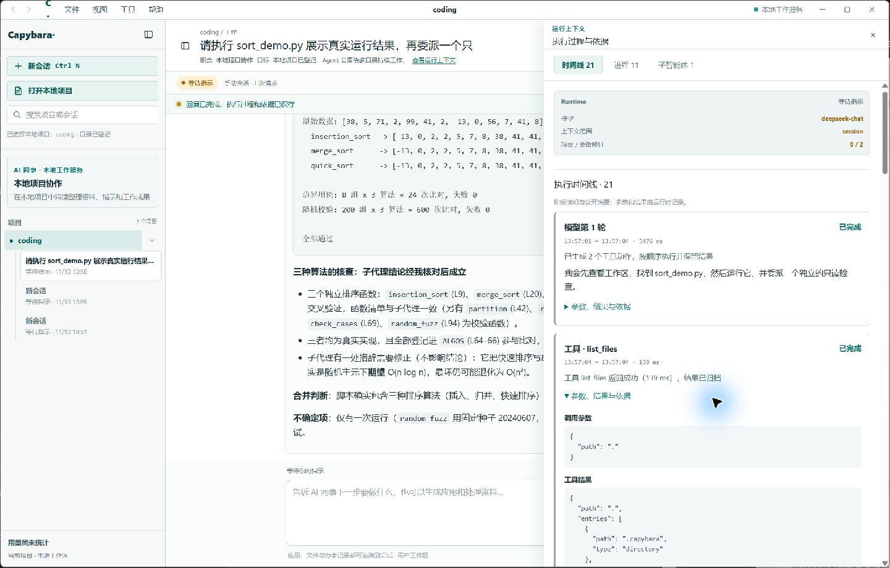
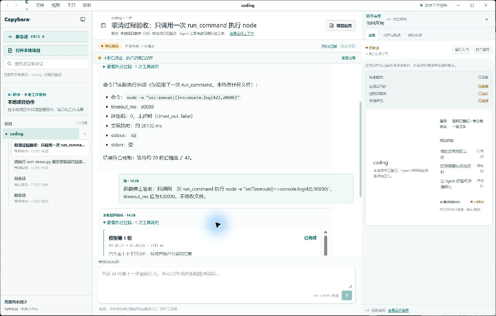

# Capybara

Capybara is a local-first system for building and running AI agents. Its focus is high-quality, maintainable context: keeping the information and working methods an agent needs organized, readable, and available as work evolves.

V2 brings the runtime and a local desktop Workbench together. You can open a local project, work with an agent, inspect its context and execution trace, and return to persisted sessions. The system is under active development; V2 is an architectural generation, not a claim that a `2.0.0` package has been released.

## The idea behind V2

An agent needs more than a long prompt or a larger context window. It needs relevant information, suitable methods, and a way to distinguish evidence from tentative observations.

Capybara separates project context from session context and uses a structured context document to organize information over time. Candidates, evidence, revisions, and review decisions give context changes an explicit path. The runtime manages context organization and control centrally, so projects do not need to build all of this coordination through their own Hooks. Hook compatibility remains available.

The goal is to make context easier for both people and models to work with, while leaving users able to inspect the work. Long-running behavior, information retention, recall quality, and end-to-end task performance still need further evaluation.

## What V2 includes

- **Local Workbench:** an Electron desktop interface for opening a local project, working in sessions, and inspecting results.
- **Structured context:** separate project and session documents, with candidates, evidence, revisions, and controlled changes.
- **Visible execution:** runtime traces show events such as model activity, tool calls, child-agent work, and artifacts.
- **Persistent work:** project context, session records, and runtime history are stored locally to support continuing work.
- **Managed capabilities:** local application and browser-related capabilities use explicit runtime boundaries; availability depends on the configured adapters and environment.
- **Context research:** the system records context-organization decisions for training and analysis. Automatic improvement and reliable long-term memory remain active areas of work, not guaranteed outcomes.

The V2 desktop chat runtime is hosted in the Electron main process and uses typed IPC. The earlier web developer interface, standalone Runner, and WebSocket Client SDK remain in the repository; they are distinct from the V2 desktop chat path.

## V2 Workbench screenshots

These screenshots were captured from the Chinese-language interface on November 10, 2026. The Workbench is evolving, so the current interface may look different.

**Runtime trace:** inspect an agent's response alongside model activity, tool calls, and the execution timeline.



**Session and project application:** review the conversation, a stopped run, and the project application panel.



## Repository layout

```text
apps/
  backend/            Agent runtime, capabilities, and backend services
  workbench/          V2 Electron desktop Workbench
  frontend/           Earlier Next.js developer interface
  website/            Project website and blog
examples/
  test-project/       Example agent project and resources
  appworld/           Historical AppWorld integration and reproduction guide
  state-bench/        STATE-Bench integration example
packages/
  client/             Browser and Node.js WebSocket Client SDK for the Runner
  protocol/           Shared runtime commands, events, and state types
docs/                 V2 design, implementation, and acceptance notes
```

## Requirements

- Node.js 22 or newer
- npm 10 or newer

## Getting started with the V2 Workbench

The current desktop workflow targets Windows. Install dependencies and build the desktop application from the repository root:

```bash
npm install
npm --prefix apps/workbench run desktop:build
npm --prefix apps/workbench run desktop:start
```

Open or select a local project directory in the Workbench and configure a model provider and API key in its settings. Configuration and credentials are stored under the current user's `.capybara` directory; project sessions and context are stored under the selected project's `.capybara` directory. Do not commit credentials or local session data.

See the [Workbench README](apps/workbench/README.md) for environment-variable configuration, development commands, and runtime details. A model provider and network access are required for model-backed conversations.

### Earlier web interface

The root development command starts the backend and the earlier web interface; it does **not** start the V2 desktop Workbench:

```bash
npm run dev
```

The default project for this interface is `examples/test-project`.

## Local Agent Runner

The earlier standalone Runner can run an Agent project without starting the developer interface. Its npm package and WebSocket API are separate from the V2 desktop runtime; installing the package does not imply that it includes the current V2 Workbench. The Runner is published as `capybara-agent`:

```bash
npm install --global capybara-agent
capybara serve ./my-agent \
  --port 3210 \
  --token local-development-token \
  --allow-origin http://localhost:3000
```

To run without a global installation:

```bash
npx capybara-agent@latest serve ./my-agent --port 3210
```

When no fixed token is supplied, the Runner prints a generated access token. Check the service before connecting a client:

```bash
curl http://127.0.0.1:3210/v1/health
```

To run the same command from this repository during development:

```bash
npm run serve:agent -- examples/test-project \
  --port 3210 \
  --token local-development-token \
  --allow-origin http://localhost:3000
```

The Runner binds to `127.0.0.1` by default. If `--token` and
`CAPYBARA_RUNNER_TOKEN` are both omitted, it generates and prints a token at startup.
Session data is isolated under `<project>/.capybara/runtime` unless `--data-dir` is supplied.

The deployment surface is intentionally separate from the developer service:

```text
GET  /v1/health
GET  /v1/agent
GET  /v1/sessions
POST /v1/sessions
GET  /v1/sessions/:sessionId
PATCH /v1/sessions/:sessionId
WS   /v1/sessions/:sessionId/events
```

All endpoints except `/` and `/v1/health` require `Authorization: Bearer <token>`.
Browser WebSocket clients may pass the same token as the `access_token` query parameter.
Project editing, training, datasets, and experiment APIs are not mounted by the Runner.

Useful options:

```text
--host <host>             Bind address; defaults to 127.0.0.1
--port <port>             Listen port; defaults to 3210
--workspace <directory>   Tool workspace; defaults to the Agent project
--data-dir <directory>    Session data directory
--token <token>           Fixed access token
--allow-origin <origin>   Allowed browser origin; may be repeated
```

The current Runner reads an unpacked Capybara project directory. The future immutable
`*.capybara-agent` project Bundle format is separate from the `capybara-agent` npm package;
Bundle construction and installation are not implemented yet.

Hook source files import `defineHook` from `@capybara-agent/sdk`. This is a virtual module
provided by the Capybara Runtime when a Hook is loaded, not a separately installable npm package.

## Client SDK

The Runner's framework-neutral TypeScript client uses only `fetch`, `WebSocket`, and standard Web APIs.
It supports modern browsers and Node.js 22 or newer.

Install the published framework-neutral Client SDK:

```bash
npm install @capybara-agent/client
```

```ts
import { CapybaraClient } from '@capybara-agent/client'

const client = new CapybaraClient({
  endpoint: 'http://127.0.0.1:3210',
  token: 'your-local-token',
})
const session = await client.createSession({ name: 'My application' })

session.on('chat.assistant.delta', ({ payload }) => {
  if (payload.channel === 'final') console.log(payload.delta)
})

const completed = session.waitFor('chat.assistant.completed')
await session.sendMessage('Inspect the current workspace')
await completed

session.disconnect()
client.close()
```

The Client SDK exposes typed Runtime commands and events, automatic initial snapshots,
Session restoration, bounded reconnection, cancellation, and typed HTTP, connection, and
command errors. It has no React dependency.

Restore a persisted Session or issue a typed low-level Runtime command:

```ts
const restored = await client.connectSession(sessionId)

await restored.send('run.pause', {})
await restored.send('runtime.snapshot.get', {})
```

See [`packages/client/README.md`](packages/client/README.md) for the SDK API and error model.

## Project Plugins

In the earlier plugin-based project format, the root project has a `capybara.plugin.json`. Installed Plugins use the same manifest
inside `plugins/<plugin-id>/` and may declare variables, Harnesses, ordinary Hooks, training Hooks,
and Tool dependencies. Tools remain project-level shared resources under `tools/` so compatible
packages can be reused by multiple Plugins.

Installing a Plugin resolves its Tool dependencies first: compatible installed packages are reused,
and missing bundled packages are installed before the Plugin is enabled. The Resources workspace
shows both each Plugin's forward dependencies and each Tool's reverse list of dependent Plugins.
Disabling a Plugin stops its runtime resources but retains its Tool dependencies. Uninstalling a
Plugin never deletes Tools automatically; when a removed Plugin leaves a Tool with no dependents,
Capybara asks whether to keep it or uninstall it in a separate confirmed action.

## Runtime Skills

In the earlier runtime interface, an Agent can search and preview GitHub Skills, inspect installed Skills, and request installation or removal through runtime system tools. These installation and removal requests create a confirmation card in the conversation, and the user must explicitly confirm or cancel the action.

Installation is pinned to a full Git commit SHA and revalidated immediately before files are written. System Skills inside `.capybara` cannot be removed, local modifications are surfaced as warnings, and confirmation state survives Session refresh and reconnection.

## Historical AppWorld result

The following result belongs to an earlier Capybara submission, **not V2**. It should not be interpreted as a V2 benchmark result.

The [`examples/appworld`](examples/appworld) project contains the training Hooks, official evaluator
adapter, runtime resources, dataset generator, state-diff helper, experiment launcher, and leaderboard
bundle tooling used by the `kecaipan capybara` submission.

Use the `appworld-official-2026-08-08` tag and follow the
[reproduction guide](examples/appworld/REPRODUCIBILITY.md) to recreate the environment and method.
The official workflow independently reported Normal TGC/SGC `85.1 / 73.2` and Challenge TGC/SGC
`73.4 / 52.5` in [AppWorld leaderboard PR #15](https://github.com/StonyBrookNLP/appworld-leaderboard/pull/15).

The public example contains code and sanitized aggregate context only. Benchmark downloads,
dataset projections, case evidence, local experiment workspaces, databases, and leaderboard bundles
remain excluded from Git.

## Verification

```bash
npm run typecheck
npm run lint
npm test
npm run build
```

Browser end-to-end tests are available separately:

```bash
npm run test:e2e
```

## Security

Do not commit `.env`, `.capybara/secrets.json`, session databases, experiment databases, logs, generated worktrees, benchmark downloads, or model-provider credentials. Example configuration uses non-routable placeholder service values.

## License

Capybara is licensed under the [Apache License 2.0](LICENSE).

## Work opportunities

I am open to relevant AI agent, software architecture, and full-stack engineering opportunities. If your company would like to learn more about my experience or request my résumé, please contact me at [pkc000pkc@gmail.com](mailto:pkc000pkc@gmail.com).
